# CodeJr

Claude Code for a real 1984 IBM PCjr. Sit at the PCjr, type "write me a snake game", and Claude writes it, builds it, and puts it on the PCjr's own disk, ready to run.

```
PCjr ──serial── WiFi modem ──TCP 4860── codejr (Go server on a modern machine)
                                          └─ claude -p (headless Claude Code)
```

The PCjr is a 4.77 MHz 8088 with no network. It dials the server through a WiFi modem on its serial port. The server keeps the chat going, runs Claude in a workspace folder, compiles what Claude writes with Open Watcom, tests it in an emulated PCjr, and sends the result down the line to `C:\CODEJR\PROGS`. Claude can also run the program on the real machine, press keys for it, read its log and look at a picture of its screen, so it can fix what the emulator got wrong.

Every picture on this page came off the real PCjr that way: the client copied video memory while the program ran and sent it up the serial line. They are shown in the standard 16 colors, because the PCjr's palette can't be read back.

## What is here

- **`CODEJR.EXE`** (`client/`): the 47 KB DOS client. Draws its own screen, keeps 200 lines of scrollback, pulls files in compressed bursts at 37287 baud (about 2,600 bytes a second of file), and sends only the changed parts of a file it already has.
- **The server** (`server/`): Go. Answers the call, runs Claude, and gives it tools to build, to run in the emulator, and to run on the PCjr itself.
- **JRGFX** (`lib/`): a graphics, input, timing and sound library for the PCjr's 160x200 16-color mode, with page flipping on the retrace interrupt, game keys that survive the keyboard's lost codes, a music player, and a test mode every game can share. Claude adds to it from the PCjr side when it solves something a second game would need.
- **MS-Kermit fallback**: needs nothing on the PCjr but Kermit 3.14. Slower, and it always works; it is how a new PCjr gets `CODEJR.EXE` the first time.

## Made with CodeJr

### Written at the PCjr

These were asked for from the PCjr's keyboard, in a CodeJr session, and written and tested by Claude without anyone touching the laptop.

#### Lemmings Junior (`apps/lemmjr`)

A Lemmings-style game: lead the walkers to the exit with eight skills (climber, floater, bomber, blocker, builder, basher, miner, digger), a release rate and a nuke. [More about Lemmings Junior](apps/lemmjr/README.md).

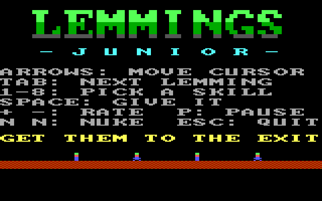 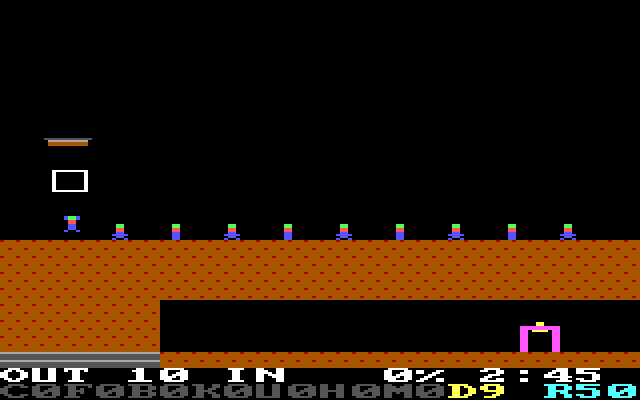

#### Jumpman Junior (`apps/jumpjr`)

A Jumpman-style platform game: platforms, ladders and ropes, and every bomb to grab. [More about Jumpman Junior](apps/jumpjr/README.md).

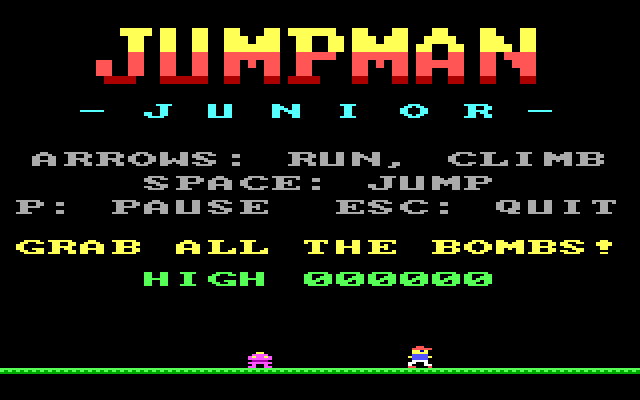 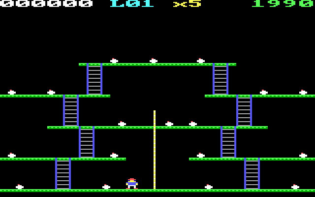

#### Swords (`apps/swords`)

Two stick figures duel with swords: slash, thrust, block, crouch and jump. The computer plays either side until you press 1 or 2. [More about Swords](apps/swords/README.md).

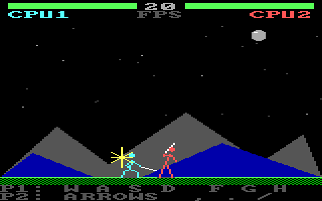 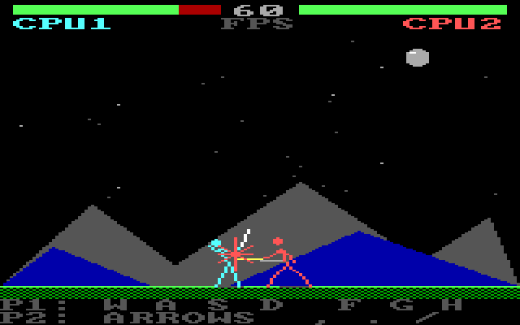

#### Mandel (`apps/mandel`)

A Mandelbrot zoom with an assembly inner loop in fixed point (the 8088 has no floating point), drawn coarse first and then sharper, with palette cycling while it works. [More about Mandel](apps/mandel/README.md).

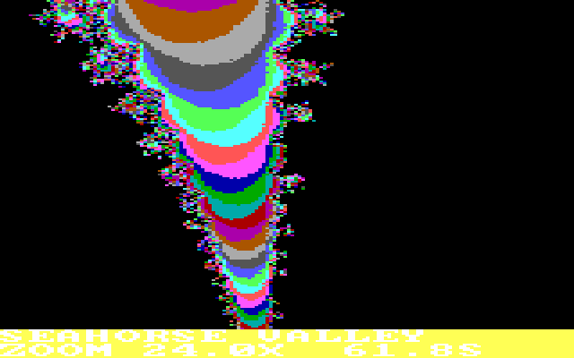

Also `apps/basic`: the first few BASIC programs CodeJr wrote for the PCjr's cartridge BASIC.

### Written on the laptop, for the PCjr

Bigger programs, written by Claude Code on the laptop with the same library and the same test loop.

#### JRDOOM (`apps/jrdoom`)

A Doom-style raycaster: zombiemen and imps, doors, a red key, a status bar with a face. About 4.5 frames a second on the real machine. [More about JRDOOM](apps/jrdoom/README.md).

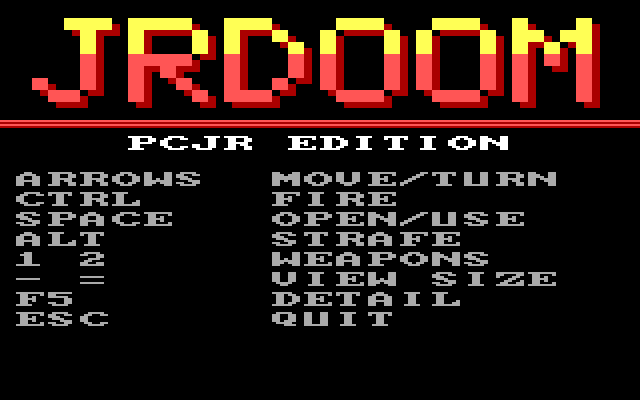 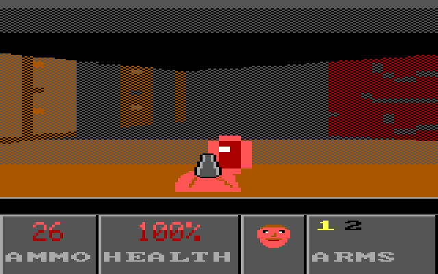

#### JRFLIGHT (`apps/jrflight`)

A filled-polygon flight simulator with a panel of round instruments, written to see whether a PCjr can beat Flight Simulator 1.0 on its own class of hardware. [More about JRFLIGHT](apps/jrflight/README.md).

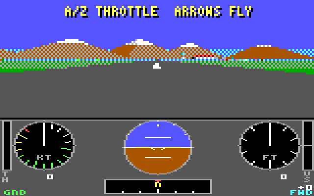 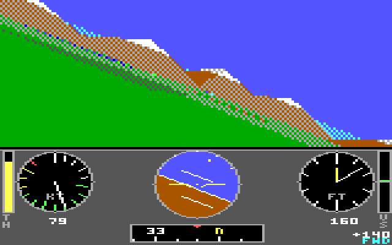

#### JRCUBE (`apps/jrcube`)

A demo: a shaded solid over a scrolling neon grid, an orb that casts a moving shadow, and a 72-second song on the PCjr's sound chip. [More about JRCUBE](apps/jrcube/README.md).

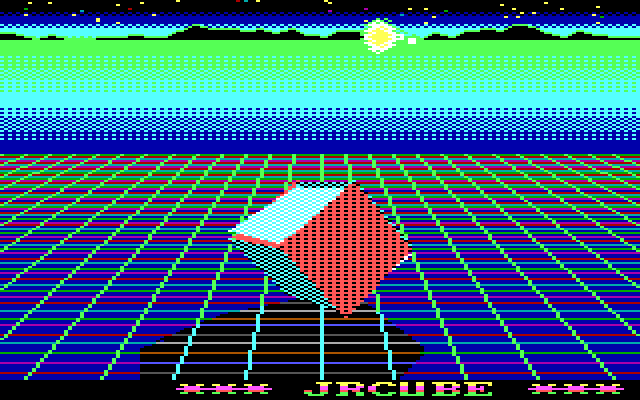

#### JRAI: PCjr meets AI (`apps/jrai`)

A two and a half minute demoscene-style demo with a three-voice chiptune and spoken dialog: plasma, fire, a tunnel that writes its own machine code, and a PCjr and a robot talking under the stars. [More about JRAI](apps/jrai/README.md).

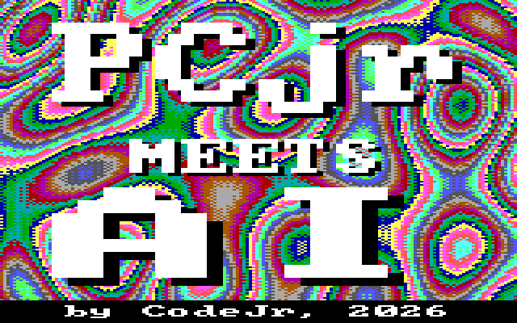 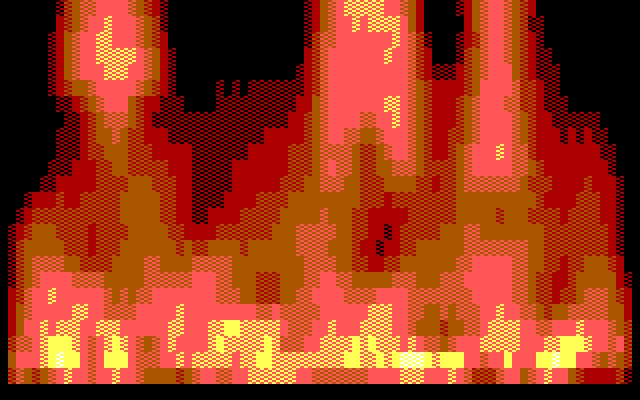
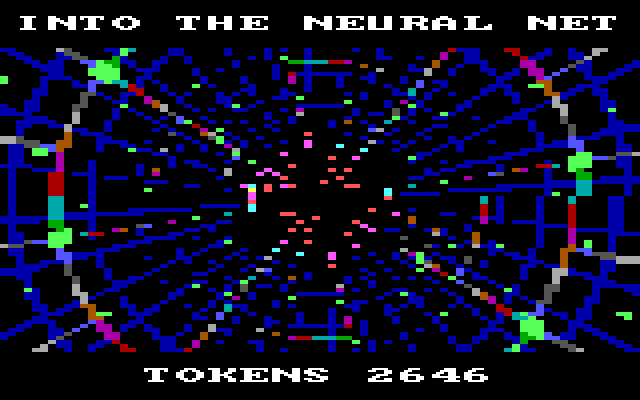 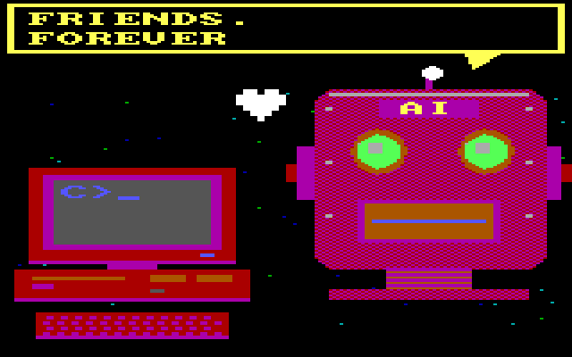

The plasma behind the title is drawn once and moved by rotating the palette, so its real colors differ from this capture.

#### SAY (`apps/say`)

Speech from the PCjr's own sound hardware, no add-on card: `/voice` in CodeJr reads Claude's answers aloud. [More about SAY](apps/say/README.md).

### Improved with CodeJr

#### Sopwith26 (`apps/sopwith26`)

David L. Clark's Sopwith 2 (BMB Compuscience, 1984), rebuilt from its released source (`apps/sopwith`, kept faithful) and made more than half again as fast on the real PCjr without changing what the game does. Then a second version with a title screen that shows the keys, pause, a top ten, seven starting levels, a flash when a building goes, and a pace that holds through a busy scene. Its license travels with it (`apps/sopwith/license.txt`).

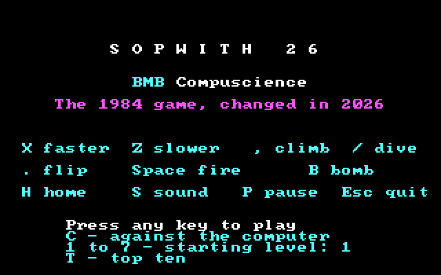 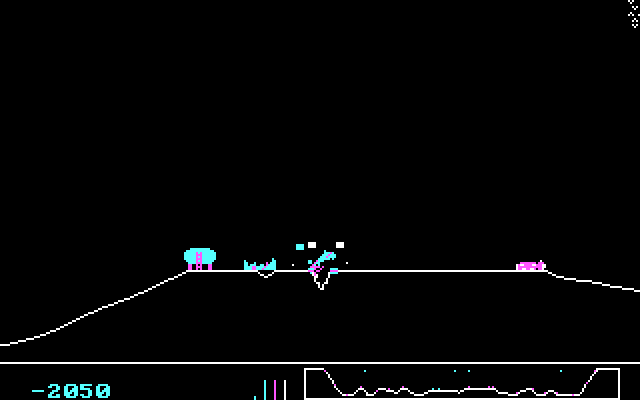

**[The whole story, with pictures, diagrams and measurements](docs/sopwith/README.md)**: the port from Turbo C, how a 1984 game draws and why that was slow on an 8088, the speed changes and how each was proven harmless, three things the emulator got wrong, and the bugs that had been there since 1984. Every speed change in full: [`apps/sopwith/SPEED.md`](apps/sopwith/SPEED.md).

## Status

Proven on a real PCjr: chat, file transfer at 37287 baud, changes-only updates (the client updates itself this way), speech, running programs and DOS commands from the laptop or by Claude, scripted keys, screenshots, and calling back by itself after a server restart. The emulator tests cover the same paths, but the emulator is not the PCjr: its timing is wrong and its serial line never loses a byte. `docs/HANDOFF.md` says which results are which.

## Running it

Everything routine is a `just` task; run `just` to list them.

```sh
just start      # build and start the server (port 4860; data and logs in ~/.local/share/codejr)
just status     # is it up, is the PCjr connected
just test       # all tests, about 12 minutes, no windows
```

Needs Go, C-Kermit and DOSBox for the tests, and Open Watcom v2 in `~/.local/opt/openwatcom` to build the DOS programs. Claude Code must be installed and logged in.

## First call from a PCjr

With MS-Kermit on the PCjr and the modem working:

```
C:\MSK314\KERMIT
SET PORT COM2
SET SPEED 9600
SET DUPLEX HALF
SET TERMINAL APC ON
CONNECT
ATD<server address>:4860
```

Press Enter at `CodeJr READY`, then type `/setup`. That installs two launchers in `C:\` and the server's address in `C:\CODEJR\CODEJR.CFG`, then sends `CODEJR.EXE` and its helpers to `C:\CODEJR`. From then on type `CODEJR` at the DOS prompt (the native client, at 37287 baud; `CODEJR /F:9600` stays at 9600), or `CJKERMIT` for the Kermit path. If the laptop's address changes, `/setup` again rewrites it.

The settings above are for one particular PCjr and Zimodem WiFi modem. The reasons for each are in `docs/HANDOFF.md`.

## In a session

Type a request and press Enter. Commands: `/files`, `/sync`, `/run`, `/send NAME` (send a file from the PCjr to CodeJr), `/get NAME` (get a file from CodeJr again), `/dos COMMAND` (run a DOS command and show CodeJr what it printed), `/voice`, `/new`, `/exit`, `/help`. `/run` numbers the programs on the PCjr; type a number to run one, and CodeJr calls back when it ends. Alt-S shows the line's error counters. `/trust` lets CodeJr run programs and change files without asking. From the laptop, while the PCjr is connected: `just pcjr "DIR"`, `just pcjr-fetch NAME`, and `just pcjr-run FOLDER PROGRAM ARGS`, which pushes the newest build, runs it on the PCjr and prints its output, exit code and `LOG.TXT`; with `KEYS='{2}{SPACE}{3}q'` it presses keys for the program, and with `SHOT=last` (or a number of seconds) it brings back a picture of the screen. `just pcjr-screen out.png` makes a picture of CodeJr's own screen as it is on the PCjr at that moment.

## Docs

- `docs/HANDOFF.md`: current state, what to test, what to build next, facts and mistakes.
- `docs/JOURNAL.md`: how it was built and debugged, step by step.
- `docs/design/PLAN.md`, `docs/design/CLIENT.md`: the original plans, with status notes.
- `lib/STATUS.md`, `lib/FAST.md`: the graphics library.
- Each folder in `apps/` has its own README, linked from its entry above.
- [`docs/sopwith/README.md`](docs/sopwith/README.md): the Sopwith port and what came after, in detail. [`apps/sopwith/SPEED.md`](apps/sopwith/SPEED.md): its speed work, change by change.

## Layout

| Folder | What |
|---|---|
| `server/` | the Go server (`just build`, `just restart`, `just live`) |
| `client/` | `CODEJR.EXE`, the PCjr client |
| `lib/` | JRGFX, the graphics, input, timing and sound library |
| `apps/` | programs for the PCjr, one folder each: `jrdoom`, `jrflight`, `jrcube`, `jrai`, `say`, `sopwith`, and the ones CodeJr wrote on the PCjr itself (`lemmjr`, `jumpjr`, `swords`, `mandel`, `basic`) |
| `tools/` | serial test tools for the PCjr |
| `emu/` | headless emulator tests |
| `docs/` | handoff, journal, and the original plans in `design/` |

On the PCjr, CodeJr's own files are in `C:\CODEJR` and the programs are in `C:\CODEJR\PROGS`, one folder per app.
