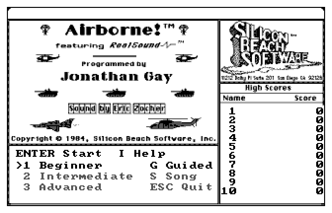
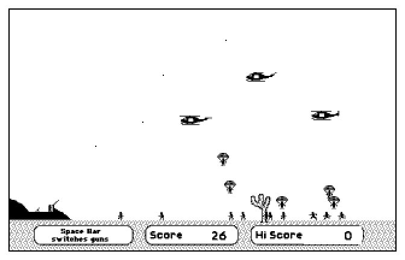
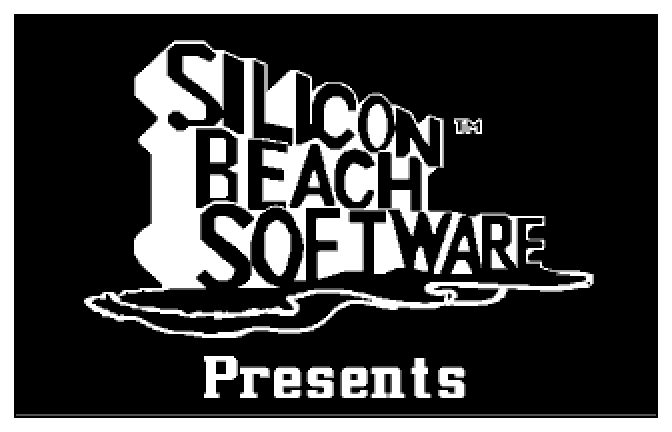
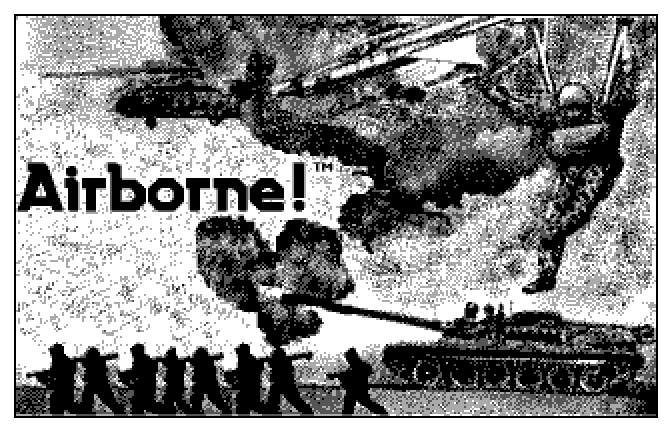
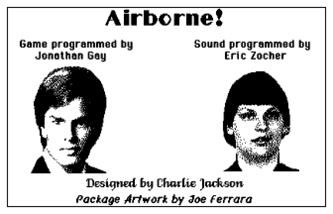
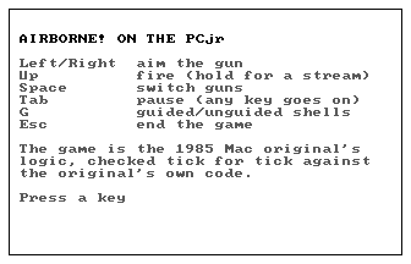
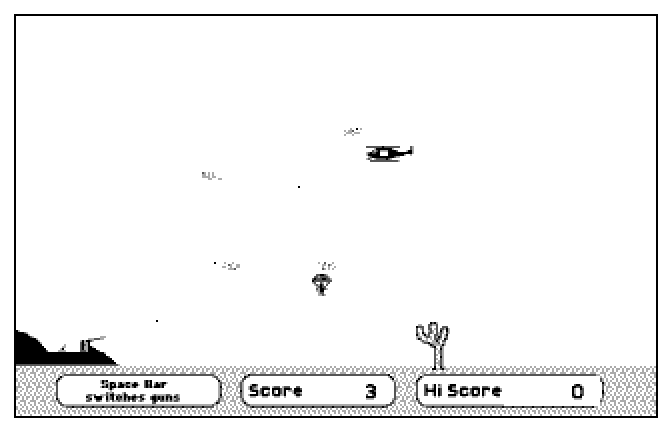
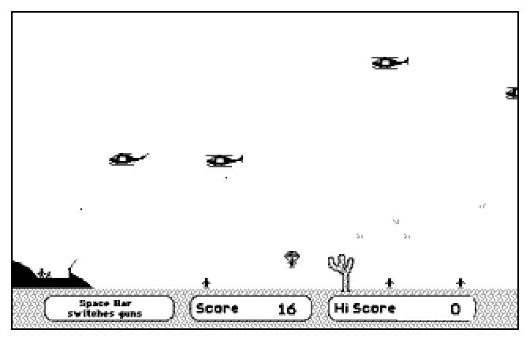

# AIRBORNE

Airborne! (1984-85, Silicon Beach Software; game by Jonathan Gay, sound by
Eric Zocher, design by Charlie Jackson) on the PCjr: 320x200 in 4 greys.

The source was never released. Everything starts from the original 400K Mac
disk (Internet Archive `mac_Airborne`), taken apart in
`~/.local/share/codejr/airborne/` (its `NOTES.md` and `re/*/REPORT.md`:
the game logic, the sprites, the sound, the pictures). None of the
original's data is in this repo: `tools/mkdat.py` makes `AIRBORNE.DAT` from
those files on this laptop.

<table>
  <tr>
    <td align="center" width="50%">
       
      <em>The title screen and high scores</em>
    </td>
    <td align="center" width="50%">
       
      <em>Level 10: helicopters and paratroopers</em>
    </td>
  </tr>
</table>

## Not on GitHub

**Airborne works on the PCjr** (Steve's PCjr, 2026-10-27), but not
everything that makes it is here:

- **`game.c`, `game.h`**: the game's logic, the original's 68000 code
  translated routine by routine. That is Silicon Beach Software's code in
  another language, so it stays on the laptop
  (`~/.local/share/codejr/airborne/port/`). `build.sh` links it in from
  there, so this folder does not build from the repo alone.
- **`AIRBORNE.DAT`, `AIRSONG.SND`, `AIRBORNE.EXE`**: the original's
  pictures, sprites, sounds and song, and the program built from both.

What is here is the PCjr side: the screen, keyboard, menus, high scores
and sound (`airborne.c`, the 8088 blitters), the tools that turn the
original disk's files into PCjr data, and the laptop test harness.

## How it is made

- **`game.c`**: the game's logic (CODE 4, 9 KB of hand-written 68000)
  translated routine by routine. Jonathan Gay's 4-letter routine names are
  kept (DJET, HELI, TANK, AIRF, MFIR, DIGM...). The state is the original's
  5.6 KB state block at the original offsets, and the game draws into a
  hidden 1-bit 512x342 Mac screen with the original OR / AND-NOT blitters,
  because a shell's hit test reads that screen (a shot passes through the
  white parts of a sprite).
- **Checked tick for tick.** The original code runs in the 68000 emulator
  of the browser version (`~/Github/Airborne`, `node tools/trace.mjs`), which
  records a checksum of the hidden screen every tick with a fixed clock and
  scripted input. `test/host.c` runs `game.c` on the laptop with the same
  input and compares: seven traces (levels 1, 5, 9, 10, 13, 25, 28; guided
  and unguided; jets, tanks, the transport, the big helicopter) match every
  tick until the game ends. The PCjr build logs the same checksum at the end
  of a `/DEMO` run with `/TIME:` (the clock seeds the game's Random): it
  matches the original too, so the 8088 assembly is exact as well.
- **`airborne.c`**: the PCjr around it. The Mac's sprites are pre-shrunk to
  5/8 by `mkdat.py` (an exact area filter: 8 Mac columns to 5, 12 rows to 7,
  greys by coverage), one image per sprite slot, placed at x * 5/8 and
  y * 7/12 of where the game drew them, ORed onto a white background. Only
  what changed is redrawn (a list of rectangles, page flipping as in
  SHREDDY's 320x200x4 mode). Menus in the ROM font; high scores in
  `AIRBORNE.HI`.
- **`ablit.asm`, `rblit.asm`**: the inner loops, for the 8088.
- **Sound.** The effects (`tools/mksfx.py`, the `SFX ` chunk): each 60 Hz
  tick of each original recording becomes SN76496 settings, a noise version
  (white noise at 4x the zero-crossing rate, or periodic noise at the pitch
  of the 43-64 Hz hums: helicopters, transport) and a tone version. As on
  the Mac the two lowest-numbered active effects are heard, the first on
  the noise voice, the second on tone 1, played from the retrace interrupt.
  The startup song (`tools/mksong.py`, `AIRSONG.SND`): the original's
  samples at 8008 Hz through SAY's player (`splayer.asm` includes
  `apps/say/player.asm`), over the box picture, a key stops it, S on the
  title plays it again. Short of memory it plays what fits, as the
  original does on a 128K Mac.

## Build and run

    just airborne            AIRBORNE.DAT (mkdat.py) and AIRBORNE.EXE
    just deploy-airborne     and queue both for the PCjr (folder AIRBORNE)

    AIRBORNE                 the game: presents screen, the box picture, title
    AIRBORNE /Q              no sound; /H the song on interrupt timing (DOSBox)
    AIRBORNE /KEYS:EX        tests: types E (Enter), X (Esc)... one every 1.5 s;
                             P saves the screen (SHOTn.PPM)
    AIRBORNE /LEVEL:n /U     start at level n (1, 5, 10 are the original's
                             Beginner, Intermediate, Advanced), unguided shells
    AIRBORNE /DEMO:t /TIME:s plays itself for t ticks (the trace's input), logs
                             fps and the hidden screen's checksum; /SHOT:t saves
                             SHOT1.PPM; /BENCH as fast as possible; /PROF times
                             each game routine

Laptop check (the trace files come from `~/Github/Airborne`):

    cc -O2 -fno-strict-aliasing -o host test/host.c game.c
    ./host CODE4.bin ref_L1.bin .

## Keys

Left/Right aim (the Mac aimed with the mouse), Up fires (hold for a
stream), Space switches guns, Tab pauses, G guided/unguided shells, Esc
ends the game. Title: Enter starts, 1/2/3 Beginner/Intermediate/Advanced,
G shells, S the song, I instructions (the original's five pages, then the PCjr keys).

## Screenshots

DOSBox (`lib/emu.sh`, `/KEYS:PPEPIPIIIIIPXX` for the menus, `/DEMO` with
`/SHOT` for the game), shown at 2x:

<table>
  <tr>
    <td align="center" width="50%">
       
      <em>Silicon Beach Software presents</em>
    </td>
    <td align="center" width="50%">
       
      <em>The box picture, while the startup song plays</em>
    </td>
  </tr>
  <tr>
    <td align="center" width="50%">
       
      <em>The title screen, menu and high scores</em>
    </td>
    <td align="center" width="50%">
       
      <em>The original's credits page</em>
    </td>
  </tr>
  <tr>
    <td align="center" width="50%">
       
      <em>The PCjr keys, the last instructions page</em>
    </td>
    <td align="center" width="50%">
       
      <em>Level 1: the first helicopters</em>
    </td>
  </tr>
  <tr>
    <td align="center" width="50%">
       
      <em>Level 5: paratroopers coming down</em>
    </td>
    <td align="center" width="50%">
       
      <em>Level 10: troopers landing by the cactus</em>
    </td>
  </tr>
</table>

## Status (2026-10-27)

**Works on the real PCjr** (Steve, 2026-10-27: "done and works"). Still
open from the first run: the lag at busy levels and the Esc report below.

- Exact against the original in DOSBox and on the laptop (above).
- Speed at DOSBox `cycles=fixed 400` (the PCjr stand-in; the real machine was
  about 20% slower on SHREDDY): the game logic 26 ms a step (it runs 20
  steps a second, so it keeps real time), drawing 27 ms a frame, 15.6 frames
  a second.
- First run on the real PCjr (2026-10-26, Steve): it ran, but laggy, and
  Esc on the title seemed to lock up. The Esc path quits cleanly in DOSBox
  (`/KEYS:EEX`), so that needs the real machine. The lag: at level 3 of the
  /DEMO run the logic takes 31 ms of every 50 ms step even in DOSBox
  (10.8 fps; the 15.6 above was an early, emptier stretch). /PROF: AIRF
  (the AA shells) 32%, HELI 18%, EXPL 13%.
- Not done: the Demo button (the original's CODE 3), the
  original's title-screen controls (here a keyboard menu over the title
  picture).
