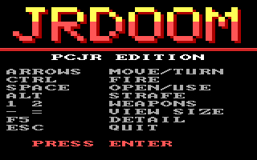
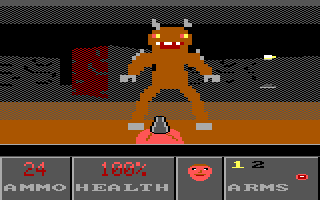
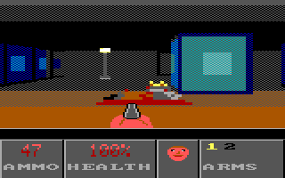
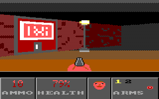
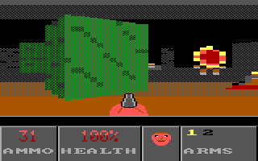
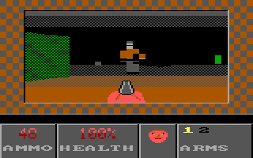
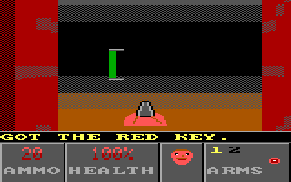
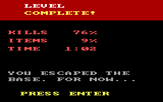

# JRDOOM

A Doom-like first-person shooter for the IBM PCjr (8088 at 4.77 MHz,
PC DOS 3.30, 160x200 in 16 colors). Real Doom can't run on an 8088, so this
is a fast raycaster in the spirit of Wolfenstein 3D and Catacomb 3-D, with
a Doom feel: a weapon at the bottom, zombiemen and imps, a status bar with
ammo, health and a face, pickups, sliding doors, a locked red-key door and
an exit switch.

 
 
 
 

## How to play

Copy `JRDOOM.EXE` to the PCjr and run `JRDOOM`. Find the shotgun, get the
red key, open the red door and press the exit switch (the red EXIT panel).

| Key | Action |
|---|---|
| Up / Down | walk forward / back |
| Left / Right | turn |
| Alt + Left / Right | strafe |
| Ctrl | fire |
| Space | open doors, press the exit switch |
| 1 / 2 | pistol / shotgun |
| - / = | smaller / bigger view (3 sizes) |
| F5 | low / high detail |
| Esc | quit |

Things in the level: zombiemen (shoot you, drop clips), imps (throw
fireballs, claw up close), medikits, stimpacks, clips, shells, the
shotgun, the red key, lamps, barrels and columns.

## Command line (for testing)

| Option | |
|---|---|
| `/DEMO:n` | autopilot plays for n frames (walks a path, opens doors, shoots what it sees), logs fps to `LOG.TXT`, then exits. Damage never kills it. |
| `/SHOT:a,b,...` | writes `SHOTnn.PPM` at those frame numbers (0 = the title, as `TITLE.PPM`); the level-complete screen is captured too |
| `/SIZE:n` | start with view size 0 (full), 1 or 2 |
| `/LOW`, `/HIGH` | detail level (low is the default) |
| `/PROF` | log where each frame's time goes |
| `/BENCH` | time the renderer and game logic on fixed views, then exit |
| `/GOD`, `/NOSOUND` | |

Headless run, as used for the screenshots:
`../../lib/emu.sh out 400 JRDOOM.EXE /DEMO:2000 /SHOT:30,75`

## Build

`./build.sh` (Open Watcom v2, `-ml -0 -ox -wx -we`, 8088 only). It
regenerates `tables.c` (`gentab.py`) and `artdata.c`/`artids.h` from
`art.txt` (`mkart.py`), assembles `fastcol.asm` and links `lib/jrgfx.lib`.

## Speed

Measured in DOSBox 0.74, `machine=pcjr`, `cycles=fixed 400`, with the
`/DEMO` autopilot playing the whole level (fighting, opening doors). The
average includes the slower first room; the range is per 64 frames.

| View | Detail | fps |
|---|---|---|
| full (160x144) | low (default) | 9.3 average, 9.2-10.3 |
| full | high | 6.2 average, 6.2-7.1 |
| medium (128x116) | low | 11.2 average, 9.8-13.5 |
| medium | high | 7.8 average, 7.5-9.1 |
| small (96x88) | low | 14.2 average, 13.2-17.5 |
| small | high | 10.2 average, 9.5-12.4 |

Before the library's page flipping and the later optimizations, the full
view in high detail ran at 4.5 fps (and 2.4 fps for the first working
version). A real PCjr is probably slower than `cycles=400`: its video
memory and the low 128K have wait states that DOSBox doesn't model.

## Design

- **Screen:** mode 8 (160x200x16) through the library's fast path
  (`fx_init`): two video pages, flipped in the retrace interrupt. The view
  is drawn straight into the hidden page, so there is no copy. The status
  bar is drawn with the library's `gfx_*` calls and copied to both pages
  with `fx_sync_rows`, and only the parts that changed are redrawn.
- **Columns:** each ray is one video byte (2 pixels), or 2 bytes in low
  detail. A color is a word: one byte for even rows, one for odd rows, so
  two colors in a byte give a free checkerboard dither. That's how
  distance shading works with 16 colors.
- **Ray casting** (`fastcol.asm`, `cast_col`): fixed-point DDA on a 32x32
  map, no floating point. Rays are cast at every 4th column. A flat wall's
  height is linear across the screen, so if both ends of a span see the
  same wall face the columns in between are interpolated, otherwise the
  middle is cast and the span split. Doors sit in the middle of their cell
  and slide sideways.
- **Walls:** 16x16 textures stored as runs per column, pre-shaded for 8
  distance levels. A table gives the screen row of each texel boundary for
  every wall height, so drawing a column is a few runs, each a jump into an
  unrolled block of stores (2 instructions per pair of rows). The ceiling
  and floor are cleared with `rep stosw` in bands (a gradient), skipping
  the middle rows every wall covers.
- **Sprites:** 32x32 art, one run list per pixel column, scaled and clipped
  against the wall heights (the z-buffer). The weapon is a compiled sprite
  (`fx_compile`).
- **Game:** 35 tics a second; monsters think at 17.5 Hz. Collision uses a
  grid of wall/door/decoration bits. Monsters wake on sight or on gunfire,
  chase, open doors, and attack when they can see you.
- **Effects:** red palette flash when hurt and a brown one on pickups
  (`fx_pal_set`, no waiting for retrace), the walls brighten when you fire,
  weapon bob, and sound on the SN76496 (shots, doors, pickups, monster
  sounds) stepped by the 18.2 Hz timer interrupt.

Files: `main.c` (loop, HUD, screens, sound, autopilot), `render.c`,
`fastcol.asm`, `game.c`, `level.c`, `art.txt`, `jrdoom.h`. Notes and lib
requests: `NOTES.md`.
