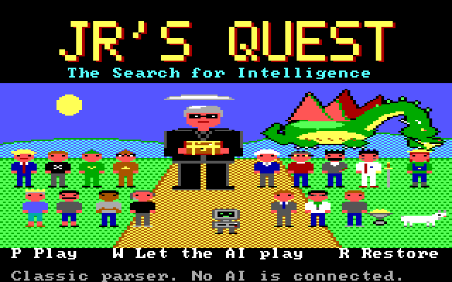
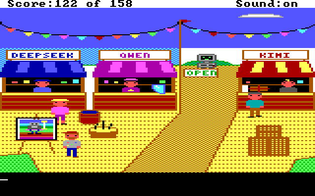

# Jr's Quest: The Search for Intelligence

A King's Quest style adventure about the AI world of 2025 and 2026, made
for the IBM PCjr. Sir Junior, a small walking PCjr sent by King Steve,
goes looking for intelligence across sixteen rooms: Castle Steve, Token
Meadow, the Data Center, Sand Hill Bridge, the Bazaar, the Golden Palace,
the Cathedral, the Cloud and more. Everybody gets ribbed and the facts are
true. You type commands, as in 1984; words the game doesn't know can go to
an AI parser, and the ending is a live talk with the Mirror.

*Captures from the JavaScript interpreter (`just quest-shots`), not from
the PCjr: no 8088 version exists yet.*

## The engine

A game is only data. One set of resource files is meant to play on two
interpreters: a JavaScript one (browser and Node, written first, the
reference) and an 8088 one for the PCjr (written second, to match the
first frame for frame). The data format is Sierra's AGI version 2, as
documented by fans, with a few opcodes added (arcs, dithered fills, the AI
parser hook) in slots Sierra left empty. Every line of the interpreter and
the tools is written here from the public format documents; no Sierra code
or data is in the repo.

## State

- **The whole game plays in a browser** on the JavaScript interpreter: 16
  rooms, 158 points, funny deaths with Retry and no dead ends, a title screen and a
  "Let the AI play" mode that plays the game through by itself.
- A scripted walkthrough (`test/walkthrough.txt`) plays it from the date
  prompt to the ending in the tests, every step on foot.
- **No 8088 interpreter yet.** Nothing here runs on the PCjr so far.

## Read first

| File | What it is |
|---|---|
| `DESIGN.md` | the game: story, map, puzzle chain, script, jokes, and the facts the puzzles rest on |
| `ENGINE.md` | the engine: what it is, what it adds to AGI, how it is built and tested |
| `FORMATS.md` | the contract every tool and both interpreters are written against |
| `GAMEPLAN.md` | the room-by-room build plan: the map, who owns which numbers, the house style |

`game/` is the source (pictures, logic, views, words, sound), `tools/`
compiles and checks it, `js/` is the interpreter, `test/` the tests.

## Tasks (from the repo root, needs Node)

    just quest            build the resources and build/jrquest.html, one file that plays offline
    just quest-test       the tests, including the whole game played start to finish
    just quest-shots DIR  play the walkthrough headless and save a PNG at each step
    just quest-lint       check every picture for leaking fills, thin triggers and stray white
    just quest-pic NAME PNG   draw one picture: just quest-pic 002_castle /tmp/castle.png
    just quest-review     build/review.html: every room, sprite and line of text, for comments
    just quest-serve      play on http://127.0.0.1:4861 with the AI parser and the live ending

`quest-serve` runs the `claude` command headless on the laptop owner's own
login for the AI parts; without it the game still plays, with the local
word list and a written ending.
