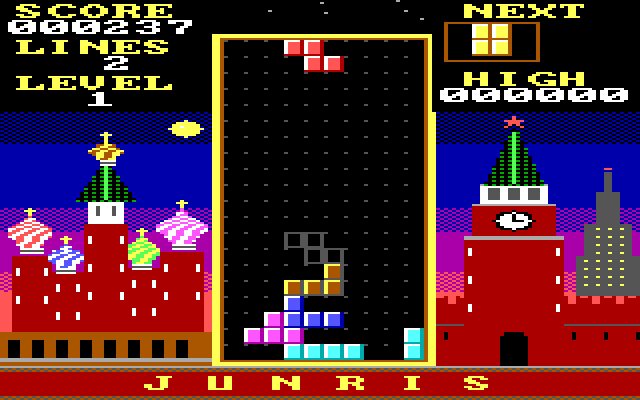

# JUNRIS

Tetris for the IBM PCjr, with Moscow behind it. Steve asked CodeJr on the
PCjr for "a great tetris clone. Junris? colorful moscow buildings in
background ... and russian style music too" on 2026-10-09, and CodeJr wrote
the whole game from there: one C file, `junris.c`.

*Emulator capture (DOSBox, `JUNRIS /TEST`), not a photo of the PCjr. The
title screen is `docs/shots/junris-title.png`, also from the emulator.*

A 10x20 well sits between St. Basil's Cathedral and the Spasskaya Tower
under a dusk sky, with Red Square and the Kremlin wall below. Korobeiniki
plays on all three tone voices of the PCjr's sound chip: the tune, a bass
line and chords.

## Keys

| Key | |
|---|---|
| Left, Right | move (hold to slide) |
| Down | soft drop |
| Up or X | rotate right |
| Z | rotate left |
| Space | hard drop |
| P | pause |
| M | music on or off |
| Esc | back to the title, then quit |

On the title screen Left and Right pick the starting level (1 to 20; the speed keeps rising to level 30). The
high score lasts until the program ends; it is not saved to disk.

## How it works

- **Mode:** 160x200 in 16 colors, through the JRGFX library's fast path
  (`lib/`). Each well cell is 5x8 pixels, so blocks start on odd pixels as
  often as even ones. With two pixels to a byte, `pack_blocks` prepares
  every block in both alignments ahead of time, and the blitter writes
  three bytes a row, keeping the neighbor's half of the byte it shares.
- **Only the movers are drawn.** The scene, the well and the settled blocks
  live in a background buffer, drawn once. Each frame only the falling
  piece and its ghost are written into the video page, and the cells they
  covered last time on that page are copied back from the background. Each
  of the two video pages keeps its own list, since a page shows what was
  drawn two frames ago. Everything else that changes (a locked piece,
  cleared rows, the score) goes through a dirty-rectangle queue from the
  background to both pages.
- **Moscow is drawn in code**, not loaded from a picture: dithered sky
  bands, onion domes with striped swirls from a width profile, the tower
  with its clock and star. It is rendered once into its own buffer and
  copied in when a game starts.
- **Sound runs in the retrace interrupt** (60 times a second, through
  `fx_irq_hook`), so the music keeps time however long a frame takes.
  Sound effects borrow the third voice and give it back.
- **The rules** follow the classic games: a shuffled bag of all seven
  pieces, a ghost piece, a short slide before a piece locks, simple wall
  kicks (try one or two cells either side), auto-repeat after a delay,
  NES-style gravity per level and NES scoring (40, 100, 300, 1200 times
  the level).

## Testing

`JUNRIS /TEST [script]` plays with a script of keys and tick counts (`L R D
U Z S X N` then a number: `L2N2S2N30` is left for 2 ticks, nothing for 2,
hard drop, wait 30), logs to `LOG.TXT`, saves the screen as `SHOT.PPM` and
exits. `JUNRIS /TEST 0` shows the title. On the laptop:

    apps/build.sh junris
    lib/emu.sh /tmp/junris 3000 apps/junris/JUNRIS.EXE /TEST

## Build

`apps/build.sh junris` (or `just project junris`) builds `JUNRIS.EXE` with
Open Watcom: 8088, large model, linked with the JRGFX library.

The working copy is the `JUNRIS` folder of the live workspace
(`C:\CODEJR\PROGS\JUNRIS` on the PCjr); `just save-projects` copies its
source here.

## Status

Played on the real PCjr on 2026-10-09. Steve found that left and right
sometimes "got stuck", which led to measuring the keyboard (`apps/keytest`,
`apps/keysim`): it loses nothing, so the repairs the key library had grown
were taken out (see `docs/JOURNAL.md`, "The key code without the
guesses"). This build has none of them and was sent to the PCjr on
2026-10-10; whether keys still stick in it has not been reported yet.
