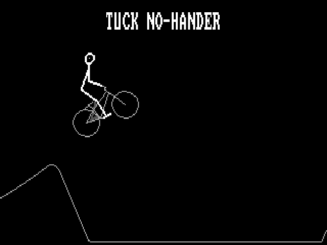

# SHREDDY

A dirt jump rider doing random tricks on the PCjr: a one-minute loop that
repeats with no seam, each trick's name at the top, in 320x200 with four
colors (black, dark grey, light grey, white). A tech demo. Any key quits.

The ride comes from Knuckle; on the PCjr it is called Shreddy.



## How it works

The ride comes from Knuckle (`~/Github/Knuckle`, the bike trick app). The
PCjr can't run Knuckle's simulation (3D rider, joint solving, physics; one
frame is about 1.5 ms on the laptop, roughly 20 s on an 8088), so the laptop
rides it and saves the lines of every frame, and the PCjr only draws them.

- **`SHREDDY.DAT`**: 1,167 frames, 20 a second, 58.4 s, 267 KB. Made by
  Knuckle's `tools/pcjr/export.mjs` (the file format is at the top of it and
  of `shreddy.c`). Polylines, ellipses (wheels, head) and dots (eyes), with
  short steps packed one per byte.
- **Simple tricks only:** one trick a jump, no combos, no doubles or
  triples, no spins past 360 (they need more frames to read), plus the flat
  tricks (manuals, wheelies, bunny hops). This file has 17 different ones.
- **Trick names:** Knuckle's own label, with its slide in and fade (the fade
  as the three greys), in the ROM's 8x8 font doubled to 8x16. It is drawn
  only when it changes or a line crosses it, so it costs almost nothing.
- **The loop:** the exporter puts two long flat stretches into the course
  (one early, one a minute later) and picks the end where the rider's pose
  is closest to the start's, crank angle included. It rides again with
  Knuckle's idle sways snapped to whole cycles of the loop's length, and
  blends the last half second into the frames that lead into the start. On
  the current file the poses at the seam match to 0.02.
- **Colors:** rider white, bike and ground light grey, the far-side limbs
  and bike parts dark grey (Knuckle's faded back side). Rider lines are
  drawn 2 pixels wide.
- **Video:** JRGFX's `fx_init` sets up two 16 KB pages and the retrace flip
  in mode 8, then `knuckle.c` switches the gate array to 320x200x4 (mode
  control 0Ah, palette mask 3). Mode 8 and 320x200x4 have the same memory
  layout, only the pixel packing differs. The BIOS mode byte is set to 4 so
  CodeJr's screenshots decode the right format.
- **Drawing** (`lines.asm`): Bresenham lines with a copy of each loop for
  even and odd rows (no register for the bank step), thick lines drawn in
  the same pass, flat lines filled a byte at a time. Each page remembers the
  span of bytes it drew on every row, and the next frame on that page clears
  only those.
- **Pacing:** playback follows the clock, so the ride keeps its real speed.
  When frames can't be drawn in 50 ms it shows every 2nd frame (or 3rd...)
  so the motion stays even; the stride goes up after 8 late frames in a row
  and back down after 30 good ones. A single late frame is just a skip.

## Run and test

```
SHREDDY                 play until a key
SHREDDY /DEMO:200       stop after 200 frames (tests)
SHREDDY /SHOT:0,292     draw every frame in order, save SHOT1.PPM, SHOT2.PPM...
SHREDDY /BENCH /DEMO:100  draw as fast as it can, log the times
```

`LOG.TXT` gets the frame count, the stride changes and the timings.

```
just shreddy            build, and check frames against the exporter's previews
just deploy-shreddy     build and queue SHREDDY.EXE + SHREDDY.DAT for the PCjr
```

To make a new ride: in Knuckle, `node tools/pcjr/export.mjs [--seed 7]
[--secs 60] [--view 8]`, then copy `SHREDDY.DAT` from the Dropbox media
folder (`pcjr/`) here, with the preview PNGs that `just shreddy` compares. It also writes preview PNGs drawn with the PCjr's own
line algorithm.

## Status (2026-10-25)

**Emulator only.** Not run on the real PCjr yet.

- Correct in DOSBox: frames drawn by `SHREDDY.EXE`, trick name included,
  are pixel for pixel the exporter's previews. The assembly was also checked
  under the unicorn CPU emulator on the laptop.
- DOSBox can't show whether the gate array switch to 4 colors displays
  right; the screenshots read video memory. First thing to look at on the
  real machine.
- Speed at DOSBox `cycles=fixed 400` (the usual PCjr stand-in): drawing
  every frame flat out, 10.3 fps (74 ms drawing, 12 ms erasing per frame).
  Playing, it averages 8.5 fps: 10 (every 2nd frame) on the easier
  stretches, 6.7 (every 3rd) in the heavier tricks. The real PCjr may be slower: DOSBox charges a
  multiply like an add and has no video wait states.

### Where the time goes (one frame, instructions)

About 12,000 in the pixel loops (~1,000 pixels), 9,000 in per-line work
(decoding steps, setting up each line, the row spans), 6,000 to 9,000 in C
(shape headers, ellipse points), 4,000 erasing. If the real PCjr is slow,
next: ellipses in assembly, keep the step state in registers, and draw the
ground only where it changed.
