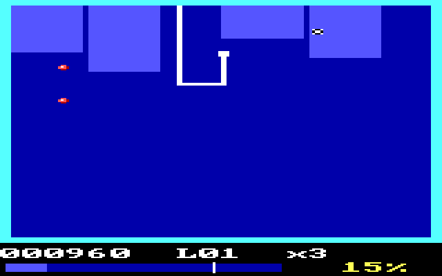

# XONIXJR

Xonix Junior: cut the sea into land and dodge the balls. A clone of Xonix
(1984), written by CodeJr on the PCjr on 2026-10-08 when Steve asked for
one. The whole game came out of a single 25,000-token reply, one C file,
`xonixjr.c`.

*Emulator capture (DOSBox, `XONIXJR /TEST` with a scripted run): four
pieces claimed and a fifth cut on its way. The title screen is
`docs/shots/xonixjr-title.png`, also from the emulator.*

You start on the land around the edge. Steer out into the sea and you
leave a trail; get back to land and every part of the sea with no ball in
it becomes land. Claim 75% to clear the level. A ball that touches your
trail, or you touching your own trail, costs a life. Crawlers move along
the land and kill you if they catch you there. Each level adds a ball
(up to 8), a crawler every second level (up to 4) and new colors.

## Keys

| Key | |
|---|---|
| Arrows or W A S D | move. Out at sea you keep going until you turn; on land you stop when you let go |
| P | pause |
| Esc | back to the title, then quit |
| Space or Enter | start, on the title screen |

Score: one point per cell claimed, times the level; a cut of 800 cells or
more counts three times ("BIG CUT! X3"); a bonus for every percent past 75.
An extra life every 20,000 points. The high score lasts until the program
ends.

## How it works

- **Mode:** 160x200 in 16 colors through the JRGFX library (`lib/`). The
  field is 80x88 cells of 2x2 pixels, kept in a background buffer. Each
  frame only the movers (you, the balls, the crawlers: 4x4 compiled
  sprites drawn one pixel around their cell) go on top, and the cells that
  changed are copied from the background to both video pages.
- **The fill** is a breadth-first flood from every ball over the sea,
  marking what the balls can reach; whatever sea and trail is left
  unmarked becomes land. It flashes white for a moment first. The queue
  is sized for the whole field, so even the first cut across an empty
  sea needs no recursion and no second pass.
- **The game runs at 24 ticks a second** whatever the frame rate: a slow
  frame is followed by up to four logic ticks, then the next frame. Balls
  skip some ticks on the early levels, so they speed up as you go.
- **Keys** go through the JRKEYS layer (`lib/jrkeys.h`): a tap shorter
  than a tick still counts, and of two held directions the one pressed
  last wins.

## Testing

`XONIXJR /TEST [script]` plays level 1 from a script (`D20R10U20`: a key
held for that many ticks, `N` for none), logs to `LOG.TXT`, saves the
screen as `SHOT.PPM` and exits. `XONIXJR /TEST 0` shows the title. On the
laptop:

    apps/build.sh xonixjr
    lib/emu.sh /tmp/xonix 3000 apps/xonixjr/XONIXJR.EXE /TEST D12R14U14N2

## Build

`apps/build.sh xonixjr` (or `just project xonixjr`) builds `XONIXJR.EXE`
with Open Watcom: 8088, large model, linked with the JRGFX library.

The working copy is the `XONIXJR` folder of the live workspace
(`C:\CODEJR\PROGS\XONIXJR` on the PCjr); `just save-projects` copies its
source here.

## Status

Played on the real PCjr in October 2026. Like Junris, it had left and
right "getting stuck", which started the keyboard measurements
(`apps/keytest`, `apps/keysim`, and "The key code without the guesses" in
`docs/JOURNAL.md`): the keyboard loses nothing, and the library's repairs
for lost keys were removed. This build has none of them and was sent to
the PCjr on 2026-10-10; whether keys still stick in it has not been
reported yet.
