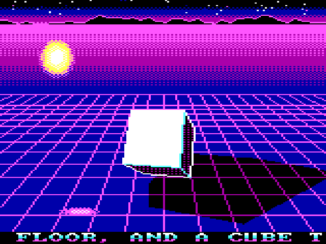

# JRCUBE

A demo for the IBM PCjr: a light-shaded solid over a scrolling neon grid,
a glowing orb circling it and casting a real-time shadow, all timed to a
72-second synthwave song on the PCjr's own sound chip. 160x200, 16 colors,
8088 at 4.77 MHz.



`shots/jrcube.mp4` (made by `video.sh`, not in git) is the whole show with
its music: the song is played into a log in the emulator and the log is
rendered by `games/jrai/render.py`, which emulates the SN76496.

## The show

The song is 38 patterns of 1.87 s (see `music.h`), and the pictures follow it:

| Patterns | Music | Pictures |
|---|---|---|
| 0-3 | intro, arpeggios, no drums | fade in, the cube turns slowly, the grid creeps |
| 4-11 | groove: kick, snare, octave bass; the hook at 8 | the orb flares on every kick, the grid lines flash on the snares |
| 12-19 | second melody, a crash every 2 patterns | the cube morphs: octahedron, back, tetrahedron, back. The floor flashes on each crash |
| 20-21 | build, snare roll | the solid glides away into the distance |
| 22-29 | the drop | a glass floor reflects it, the grid runs twice as fast, the spin speeds up, and it morphs to a cuboctahedron and back twice |
| 30-31 | crash, a noise sweep, drums stop | the cube bursts into its six faces; they tumble, each casting its own shadow |
| 32-33 | riser | the faces fly back together, landing on the crash at 34 |
| 34-37 | the hook, then it rings out | glass floor again, fade out; the show loops |

## Run it

```
JRCUBE            the show, looping; Esc, Space or Enter quits
JRCUBE /SPLIT     the same with a 32-color sky (see below)
```

F shows the frame rate (and `S` when the split is running, `S?` if it
gave up). E turns the neon edges off and on.

| Option | |
|---|---|
| `/SPLIT` | the sky gets its own 16 colors: a red and purple sunset and a striped sun |
| `/QUIET` | no sound |
| `/BENCH:n` | run n frames, write the frame rate to `LOG.TXT`, exit |
| `/PROF` | with `/BENCH`: time per stage, in `LOG.TXT` |
| `/AT:p` | the pictures start at pattern p (tests; the music still starts at 0) |
| `/GIF:n` | n frames at fixed 1/15 s steps, each saved as `Fnnn.PPM` |
| `/VIDEO:n` | the same, with the music, logging the sound chip to `SND.BIN` |
| `/NOEDGE` | start with the edges off |
| `/ONEPAGE` | act as if there were no second video page (tests the fallback) |
| `/RUN:n` | the normal mode for n frames, for tests |

Needs a PCjr with memory above 128K (two 16 KB background buffers and two
video pages). This PCjr reserves only one 16 KB video page, and a 75 KB
program may load where the library would claim the second one. Then the
library falls back to one page plus a RAM buffer and copies only the
changed areas to the screen. JRCUBE marks its own direct writes, so that
mode works too (tested with `/ONEPAGE`).

## /SPLIT: 32 colors on a 16-color machine

The PCjr has 16 palette registers. `/SPLIT` gives the sky a different 16:
the retrace interrupt writes the sky's palette during the vertical retrace,
waits for the display to reach row 18, and writes the floor's. The wait
counts the display-enable bit of port 3DAh (it toggles at the start and end
of every displayed line), with a limit, so if the real hardware doesn't
behave that way the split turns itself off (`S?`) instead of hanging.

Rows 16-20 are black mountains in both palettes, so the switch can land a
row or two off, and the moment of blanking while the palette is written,
without showing.

The cost is the wait: the CPU idles from the retrace to row 18 every frame,
about a quarter of its time (6.8 fps against 9.2 in DOSBox). DOSBox can't
show a mid-frame palette change, so the screenshots draw it the way it
should look. **Only the real PCjr will tell whether it works.**

## Build

```sh
demos/cube/build.sh            # JRCUBE.EXE (cube.c, music.c, shapes.c, lib/jrgfx.lib)
python3 demos/cube/genshape.py > demos/cube/shapes.c   # after changing the shapes
demos/cube/shots.sh 100        # shots/jrcube.gif (from pattern 12) and shots/frame.png
demos/cube/video.sh            # shots/jrcube.mp4, the whole show with sound (about 10 min)
demos/cube/musictest.sh        # shots/song.wav, the song alone
lib/emu.sh /tmp/out 400 demos/cube/JRCUBE.EXE /BENCH:60 /PROF
```

## How it's done

Every trick is about touching as few bytes, and running as few
instructions per screen row, as possible.

- **No clearing, no full-screen copy.** The sky, mountains and grid are
  drawn once into a RAM buffer. Each frame, `fx_restore` copies back only
  the bytes the hidden page drew two frames ago, row by row.
- **The grid scrolls for free.** Its horizontal lines are drawn 4 times as
  dense as they look, in 4 palette entries with one lit, and the retrace
  interrupt rotates them (`fx_pal_anim`). The drop just rotates faster.
- **Beat flashes for free.** `fx_pal_flash` shows a palette entry in
  another color for a few retraces: white grid lines on the snare, a light
  blue floor on the crash. The kick swaps the orb's sprite for a flare.
- **Morphing that stays exact.** The solid is the intersection of a cube
  and the two tetrahedra that make an octahedron. Sliding their sizes goes
  cube, truncated cube, cuboctahedron, octahedron, or cube to tetrahedron,
  and every step is convex. `genshape.py` finds every step's corners,
  faces and edges offline (50 shapes, 4 KB); the PCjr only rotates corners.
  Back-face culling and the shadow (the convex hull of the corners'
  shadows) are exact for every shape.
- **The shadow** is filled by copying from a second, darkened copy of the
  floor (`fx_poly_src`), so the grid lines stay visible inside it.
- **Smooth shading with 16 colors.** Each face is lit at its top and bottom
  corners (diffuse from the orb, a Blinn highlight, a fill light from the
  camera), and the light is interpolated down the rows through a 2x2
  ordered dither between ramp colors (`fx_poly_rows`, XLAT-made row
  patterns): 13 to 17 shades per face from 4 or 5 colors.
- **The glass floor** draws the mirrored solid's faces with every other
  pixel left as the floor, fading out over 32 rows. To bring the
  reflection into view the solid glides back into the distance for the drop.
- **The explosion** moves each face out along its normal, tumbles it about
  one of its edges and sinks it a little, drawing far to near, both sides,
  with a shadow each. It is a function of the song position, so the faces
  land back exactly on the beat.
- **Cheap 3D.** Every multiply is one 8088 `IMUL` and every divide one
  `IDIV` (helpers in `cube.c`); normalizing uses a table square root.
  The math runs before `fx_begin`, overlapping the wait for the last flip.
- **The music** is a tracker in the retrace interrupt (`music.c`): lead
  with vibrato, octave bass, arpeggiated chords one note per 60 Hz tick,
  and noise drums. It sets `mus_kick`, `mus_snare` and `mus_crash`, and
  the pictures read the song position from its tick counter, so they stay
  in time at any frame rate.

## Speed

Emulator-only numbers (DOSBox `cycles=fixed 400`, which charges one cycle
per instruction, so multiplies and divides look far cheaper than on a real
8088, and port writes far dearer). Not yet run on the real PCjr.

| Section | fps |
|---|---|
| Cube (groove) | 8.9 |
| Octahedron morph | 7.5 |
| Tetrahedron | 11.5 |
| Drop (glass floor) | 5.9 |
| Explosion | 5.2 |
| Any section with `/SPLIT` | about a quarter lower |

The single-cube version before the music and the morphing ran at 10.2.
