# Sopwith on a real IBM PCjr: the port, and what came after

Sopwith is a 1984 side-scrolling biplane game for the IBM PC, written by
David L. Clark at BMB Compuscience. Its source was released in 2000. This
is the story of building that source for a real IBM PCjr with today's
tools, making it more than half again as fast without changing a single
thing the game does, finding bugs that had been in it since the start,
and then making a second version with the things a player would ask
for.

Two programs came out of it, built from one source:

| | | |
|---|---|---|
| **Sopwith 2** | `apps/sopwith` | The faithful one. The 1984 menus, look and game, pixel for pixel. |
| **Sopwith26** | `apps/sopwith26` | The same game with a one-key start, pause, a top ten, a choice of level, a flash when a building goes, and a pace that holds in a busy scene. |

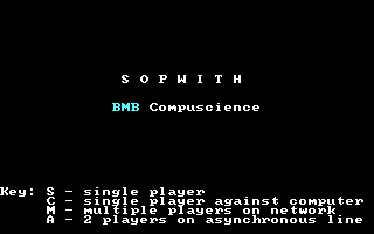 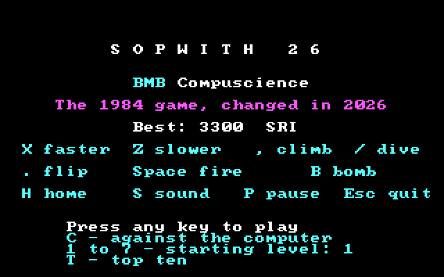

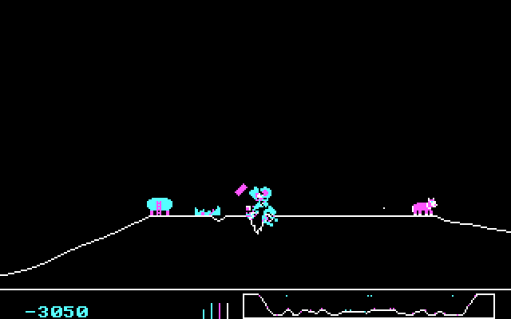 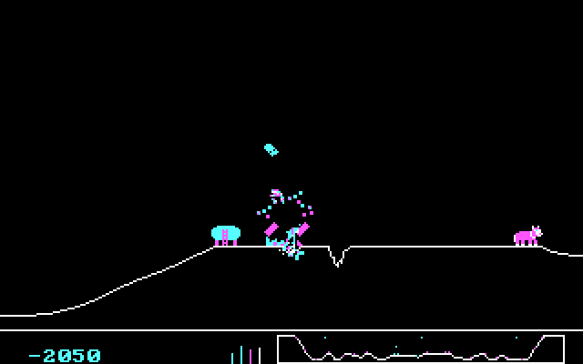

Every picture here except the top ten came off the real PCjr: the game
saved its 16 KB of screen memory to a file and the file came back over the
serial line. They are drawn in the standard CGA colours.

Contents:

1. [Where the game came from](#1-where-the-game-came-from)
2. [The port](#2-the-port)
3. [How the game draws, and why that was slow](#3-how-the-game-draws-and-why-that-was-slow)
4. [The speed work](#4-the-speed-work)
5. [What the emulator got wrong](#5-what-the-emulator-got-wrong)
6. [Bugs that had always been there](#6-bugs-that-had-always-been-there)
7. [Proving nothing changed](#7-proving-nothing-changed)
8. [Sopwith26](#8-sopwith26)
9. [What didn't work](#9-what-didnt-work)
10. [What is left](#10-what-is-left)

The measurements and every speed change in full are in
[`apps/sopwith/SPEED.md`](../../apps/sopwith/SPEED.md). The day-by-day
account, wrong turns included, is in [`docs/JOURNAL.md`](../JOURNAL.md).

## 1. Where the game came from

BMB Compuscience of Milton, Ontario sold a network for PCs called Imaginet,
and Sopwith was written to show it off: several machines, one sky. That
origin shapes the whole program. Machines on the network exchanged only
key presses, never positions, so the game had to be exactly repeatable:
the same keys on the same frame must give the same world on every machine.
It uses whole numbers only, counts frames instead of reading a clock, and
takes its random numbers from one seed.

That property turned out to be the most useful thing about it forty years
later. A game that is exactly repeatable can be tested by comparing
screens.

In 1999 and 2000 Andrew Jenner reverse-engineered Sopwith 2 from the
executable into a single 3,500-line C file plus a little assembly, and it
was released with David Clark's blessing and licence. That file is the
starting point here, by way of the
[Retro-Jack/sopwith-genx](https://github.com/Retro-Jack/sopwith-genx)
repository, whose first commit is the release untouched. `apps/sopwith/orig`
keeps it exactly as it came.

The licence asks four things of anyone who changes the game, and they are
kept: the copyright stays on the screen, changed files say so, the source
is distributed, and no money is charged. Every change in the source is
marked `CodeJr:`.

## 2. The port

The released source was written for Turbo C 2.0 and the A86 assembler.
This project builds with Open Watcom 2, for the 8088 only, in the small
memory model the original used.

| The original assumed | What was done |
|---|---|
| Turbo C's `inportb`, `outportb`, `farmalloc`, the `_DS` pseudo-register, a calibrated `delay` | A small header of Open Watcom stand-ins (`owcompat.h`) |
| A86 assembly for the timer and keyboard interrupts and some helpers | Rewritten for Watcom's assembler (`sopsys.asm`); the helpers that needn't be assembly became C (`sopsys.c`) |
| The interrupt routines can run C on whatever stack was interrupted | They switch to a stack of their own. Small-model C assumes the stack and data share a segment, and an interrupt can arrive while DOS or the BIOS is on its own stack |
| A keyboard interrupt reads the key from port 60h | On a PCjr the keyboard arrives a different way and the BIOS calls the handler with the key already in a register. The handler keeps it |
| The compiler won't notice a variable changing behind its back | Open Watcom's optimizer does notice that a loop waiting for the next clock tick never changes the tick count itself, and makes the loop endless. The variables the interrupts change are now `volatile` |

It ran in the emulator and, the same evening, on the real PCjr, with the
screen matching the emulator's byte for byte.

The straight port managed 8.1 frames a second in the emulator. The game
is meant to run at 9.1.

## 3. How the game draws, and why that was slow

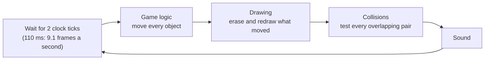

The limiter at the top can only hold the game back. If the other four
steps take more than 110 ms the game simply runs slow for that frame, and
on a 4.77 MHz machine they often did.

The screen is CGA mode 4: 320 by 200 pixels, 2 bits each, 4 pixels to a
byte. Even and odd lines live in two separate 8 KB banks:

```
B800:0000  line 0    ████████  80 bytes
B800:0050  line 2
   ...                           even lines
B800:2000  line 1    ████████
B800:2050  line 3
   ...                           odd lines
```

Everything is drawn with XOR. Draw a sprite once and it appears; draw it
again in the same place and it is gone, leaving whatever was underneath.
The game never keeps a copy of the background. It remembers where each
object was drawn and erases it by drawing it again.

Collisions used the same trick. To see whether two objects touch, the
1984 code drew the first into a spare corner of an off-screen buffer,
XORed the second in while watching for pixels that were already set, and
then wiped the corner:

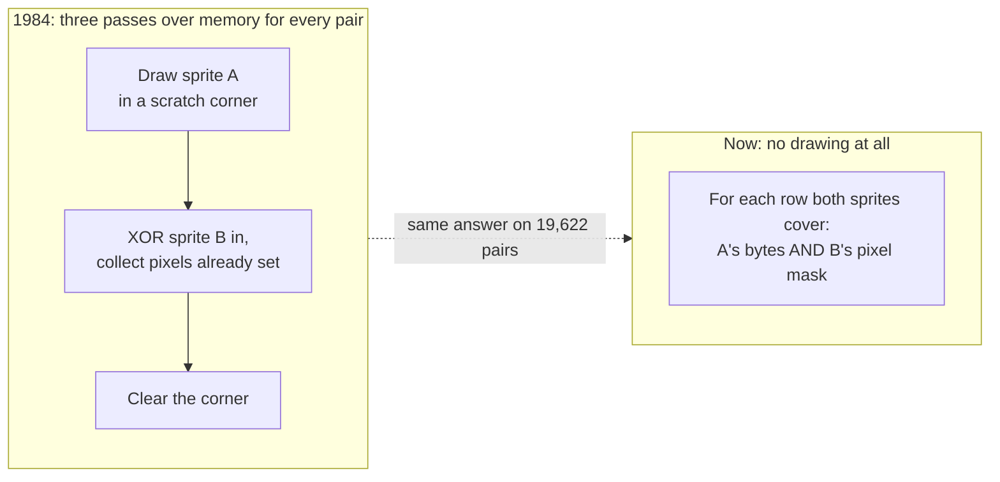

Three habits of the original cost the most on an 8088, which multiplies
slowly and shifts one bit at a time:

- **A multiply for every pixel's address.** `((199-y)>>1)*80` plus the
  bank, in every sprite row, every pixel and every point of the ground.
- **A variable shift for every sprite byte.** A sprite can start at any of
  4 positions inside a byte, so each byte was shifted by 0, 2, 4 or 6
  bits, in a loop.
- **A function call for every pixel of the ground line**, about 700 a
  frame while the screen scrolls.

## 4. The speed work

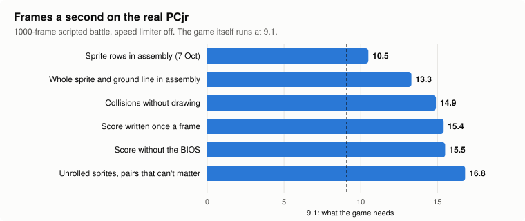

| Step | Frames a second on the PCjr |
|---|---|
| Sprite rows in assembly (first build measured there, 7 October) | 10.5 |
| Whole sprite and ground line in assembly | 13.3 |
| Collisions without drawing | 14.9 |
| Score written once a frame | 15.4 |
| Score without the BIOS | 15.5 |
| Unrolled sprite routines, pairs that can't matter left untested | 16.8 |

The speed limiter is off for these runs. With it on, the game runs at
9.1; the point of the headroom is that fewer frames go over.

In order, and in brief (the long version is in
[SPEED.md](../../apps/sopwith/SPEED.md)):

1. **Tables instead of arithmetic.** A 200-entry table of line addresses
   replaced the multiply. Tables of every byte value already shifted by 0
   to 3 pixels replaced the shifts, with the collision masks worked into
   them. Emulator: 8.1 to 11.0 frames a second.
2. **Sprite rows, then whole sprites, in assembly.** Eight instructions a
   byte. Then the C around each row cost more than the row, so the whole
   sprite and the whole ground line moved into one assembly file.
3. **Collisions without drawing.** Compare the sprites' own bytes through
   the same tables. Collisions went from 22.7 ms a frame to 13.6 on the
   PCjr.
4. **The score.** Found only on the real machine: see the next section.
5. **Routines for exactly 2 and 4 bytes a row**, the two sprite widths the
   game has, with no inner loop.
6. **Not testing what can't matter.** A plane that is shot down falls
   through its own debris. The game tested it against every piece, every
   frame, and nothing could come of it. Those tests were 1,269 of the
   1,770 in the test battle.

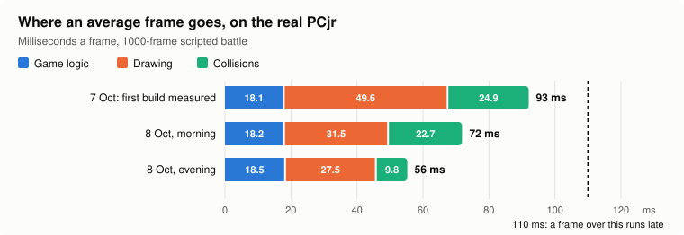

| | Game logic | Drawing | Collisions | Total |
|---|---|---|---|---|
| 7 October | 18.1 ms | 49.6 ms | 24.9 ms | 93 ms |
| 8 October, morning | 18.2 ms | 31.5 ms | 22.7 ms | 72 ms |
| 8 October, evening | 18.5 ms | 27.5 ms | 9.8 ms | 56 ms |

The average was never the whole story. What a player feels is the frames
that go over 110 ms, and those come with explosions: up to fifteen pieces
of debris, each drawn, moved and collision-tested. So debris was measured
on its own, by sorting every frame's time by how many pieces were flying:

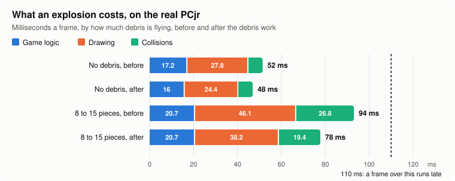

| Debris flying | Before | After |
|---|---|---|
| None | 52 ms | 48 ms |
| 8 to 15 pieces | 94 ms | 78 ms |

One explosion now fits in a frame with room to spare.

## 5. What the emulator got wrong

Most of the work was done against DOSBox, with the real PCjr as the
judge. Three times the judge disagreed, and each time it mattered.

| | DOSBox | The real PCjr | What it hid |
|---|---|---|---|
| Writing the score through the BIOS | 3.3 ms | 22.7 ms | The slowest frames in the game. Debris from one explosion could score six times in a frame, and the number was rewritten each time: 189 ms of one frame |
| Game logic | 12.7 ms a frame | 18.5 ms | DOSBox charges a multiply the same as an add |
| Memory given to the program | all zeros | whatever ran last | A 1984 bug (next section) |

DOSBox runs BIOS calls as native code on the host, so anything the game
does through the BIOS looks free. The fix for the score was in two parts:
write it once at the end of the frame instead of every time it changes,
and draw its six characters straight into screen memory from the ROM's
own character table. 22.7 ms became 6.3, and frames over 165 ms went from
20 in a thousand to 2, then to none.

Even the stopwatch was wrong at first. The timer is read with interrupts
off, and if a clock tick arrived in that instant the time stepped back 55
ms. One frame was reported as taking an hour.

## 6. Bugs that had always been there

**Scores that depended on what ran before the game.** The game's object
table was never cleared. Debris never sets one of its fields, and the
collision code reads that field to decide whether debris scores. On the
real PCjr the same scripted battle ended on -750, then -1950, then a
third score, depending on what the previous program had left in memory.
DOSBox hands out zeroed memory, so it always agreed with itself. For a
game designed so that two machines stay in step given the same keys, this
is the bug that would have broken it. Found by comparing the PCjr's
screen with the emulator's and seeing the same scene with a different
score.

**Recording a game never worked.** The source has options to record a
game's keys and play them back. The file's header was written as one word
and skipped as two on reading, so a playback never reached its end; and
the recording buffer lived in far memory but was handed to file routines
that could only reach near memory. Both fixed. A 1000-frame flight is 1.3
KB and plays back to the identical screen.

**A buffer cleared with its arguments swapped**, so it cleared nothing.
Left alone in the faithful build: the game works, and it is the
original's behaviour.

And one of our own. Moving the sprite routine into assembly, the screen
segment was passed in the ES register. Open Watcom silently drops ES from
an external routine's parameter list and shifts every later argument
along by one. The emulator test "passed" because the script compared
against the previous build's leftover screen. The real PCjr locked up.
Both were fixed, and the lesson went into the test script: delete the
old answer before asking for a new one.

## 7. Proving nothing changed

Every speed change had to leave the game exactly as it was. The game's
1984 design made that checkable.

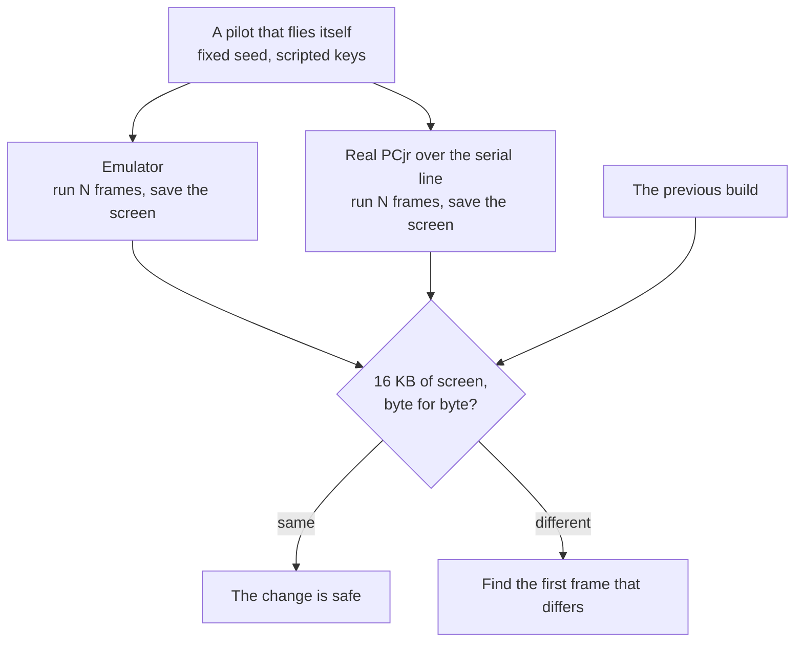

- **A pilot that flies itself.** A test mode starts a game with a fixed
  seed and a scripted pilot (take off, climb and dive, fire every 7th
  frame, bomb every 23rd), runs a set number of frames, writes the screen
  and the timings to files, and exits. On the real PCjr the files come
  back over the serial line.
- **Screens compared byte for byte**, at frames 330, 1000, 2500 and 6000,
  against the build before, and the PCjr's against the emulator's.
- **Both at once.** Where a new routine replaces an old one, a checking
  build runs both on every call and counts disagreements. The new
  collision tests: 19,622 calls, none different.
- **With and without.** Where pairs are skipped, a build with the
  skipping off must give the same screen. Tried to 12,000 frames against
  the computer on level 5.
- **A state number**, for the one time the picture differed on purpose: a
  sum over every object's position, type, status and score.

## 8. Sopwith26

Sopwith26 is the same source built with one switch (`SOPWITH26`), so
every speed fix reaches both and the two can always be compared. Its
screens match the faithful build's at every frame; what differs is around
the game, not in it.

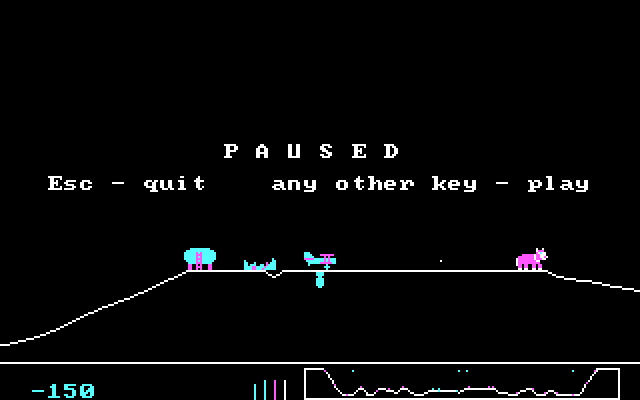 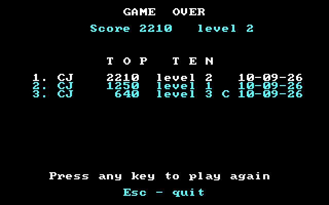

(The top ten above is from the emulator: taking that picture on the real
machine would have put a test score in the real table.)

| | |
|---|---|
| **One key to start** | The original asked two questions before every game. One of them, "IBM or non-IBM keyboard", was for 1984 clones; the other offered network and serial games whose code was never in the released source. The title screen shows the keys and says "Press any key to play" |
| **Pause** | `P` pauses. Esc pauses too, and Esc again quits, so one slip doesn't end a game |
| **A top ten** | Three initials, score, level and date, in a text file beside the program |
| **Starting level** | The game has seven levels: each win makes everything fly faster, and from the second the enemy's buildings shoot back. Pick one on the title screen |
| **A flash** | The background goes red for one frame when a building blows up. On a PCjr that is one write to a palette register: nothing is drawn |
| **A pace that holds** | See below |

### Keeping the pace

The 1984 limiter waits if a frame was quick and does nothing if it was
slow. Sopwith26 keeps count of how far behind the clock it is. When it is
two ticks behind, it runs the next frame's game logic and leaves out the
drawing, which is the larger part of a frame, and so catches up.

```
Each frame should take 110 ms. Two late frames in an explosion:

1984 limiter   |--110--|-----150-----|-----150-----|--110--|   520 ms: 80 ms behind, for good
Sopwith26      |--110--|-----150-----|-70-|--110--|            440 ms: caught up
                                      ^ game logic only, nothing drawn
```

Leaving out a frame's drawing is not as simple as not calling it, because
of the XOR. The game erases each sprite by drawing it again where it
remembers drawing it. After a frame that wasn't drawn, those memories
must not move on; objects that were deleted in it must still be wiped,
since their slots are reused in the next; and the ground line has to be
marked as out of date.

The test for it: leave out two frames' drawing in every three for 2,500
frames. The final screen is identical to a run that drew every frame.

On the real PCjr, 1000 frames should take 2000 clock ticks. The faithful
build takes 2033. Sopwith26 takes 2009, leaving out 12 frames' drawing.

## 9. What didn't work

- **Redrawing only the parts of the ground line that changed.** While the
  plane moves, nearly all of it changes, and the test cost more than it
  saved.
- **Sparks.** Showing each piece of debris as a small bright block with
  single-pixel sparks flying out was meant to look better and cost less.
  On the real PCjr it cost the same (37 ms of drawing in an explosion
  frame against 39), and on the real screen the 1984 debris looked
  better. It was taken out again; only the flash that came with it stayed.
- **A theory about buildings.** The guess was that debris sits on the
  ruin of the building it came from and is tested against it for nothing.
  A count said 0.3 such pairs a frame. The same count showed where the
  tests really went: the falling plane.
- **Timing every object.** To find which objects were slow, each one's
  update was timed. The timing cost 10 ms a frame on the PCjr, more than
  anything it was looking for. It found its answer (the 100 ms frames
  were the test pilot crashing and the status area being rebuilt) and was
  moved to a build of its own.

## 10. What is left

- **Drawing** is still the largest part of a frame. A sprite that lands
  on a byte boundary could be XORed a word at a time with no table at
  all.
- **Game logic** is 18.5 ms on the PCjr against 12.7 in the emulator,
  which means multiplies. Not yet profiled in a way that doesn't disturb
  it.
- **The PCjr's three-voice sound chip.** The game uses the PC's beeper,
  one tone at a time, so the engine cuts out when a gun fires.
- **Two players.** The game was built for it, and the network code was
  never in the released source. A PCjr with a WiFi modem and a game that
  is exactly repeatable is most of what it needs.

## Credits

Sopwith and Sopwith 2: David L. Clark, BMB Compuscience, 1984 to 1985.
Source reverse-engineered and released: Andrew Jenner, 1999 to 2000.
Arrow keys: Retro Jack, 2026. The licence is in
[`apps/sopwith/license.txt`](../../apps/sopwith/license.txt).

The port, the speed work and Sopwith26 were written by Claude (Anthropic)
working with Steve, who owns the PCjr, played the builds on it and said
which ideas were worth keeping.
