# JRFLIGHT

A flight simulator for the IBM PCjr (8088 at 4.77 MHz, PC DOS 3.30, 16
colors), written to answer a half-serious question: can the PCjr beat
Microsoft Flight Simulator 1.0 (1982) on its own class of hardware?
JRFLIGHT draws filled, shaded, 16-color 3D scenery with sky and ground,
has a full panel of round-dial instruments, and flies a simple but honest
flight model, all in integer math (the 8088 has no floating point).

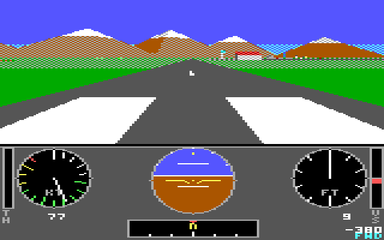

## Flying

Run `JRFLIGHT` from DOS. You start lined up on runway 36 at Jr Field with
the engine idling.

| Key | Does |
|---|---|
| Up / Down arrows | stick forward (nose down) / back (nose up) |
| Left / Right arrows | bank left / right (steer the nosewheel on the ground) |
| A | throttle up |
| Z | throttle down |
| Space or B | wheel brakes (hold) |
| [ and ] | elevator trim, nose down / nose up |
| 1 2 3 4 | look forward / left / right / back |
| D | line doubling on/off: high detail (160x120 view) or low (160x60, each line shown twice) |
| W | wide pixels on/off (80 columns: every byte one color) |
| - and = | smaller / larger window (full windshield, medium, small) |
| F1 F2 F3 | full / medium / small window directly (Fn+1..3 on the PCjr keyboard) |
| F | the fastest combination (low detail, wide pixels, small window), and back |
| P | pause |
| R | back to the runway |
| Esc | quit |

The stick springs back to center when you let go, the way a real one does
with your hand off it.

A first flight: press A until the throttle bar (left of the panel) is full.
Keep straight with the arrows. At about 55 knots, hold Down to raise the nose
a little; the airplane lifts off at 50-65 knots, depending on how hard you pull. Climb at 70-80 knots
(nose about 10 degrees up on the attitude ball). Level off, pull the
throttle back to about 75%, and look around: the town of Juniper is
north-east, the lake north-west, the mountains north, and a second airfield
with an east-west runway lies past the town, about 7 km north-north-east.

To land, line up with a runway, throttle back to 25-30%, and hold about 70
knots coming down. Over the runway, close the throttle and raise the nose a
little to flare. Touch down slower than 700 feet per minute down, wings
within 20 degrees of level, and not nose first, or it's a crash (you get put back on the runway
after three seconds). Flying into a mountain or a building counts too.

Things to try: stall it (slow down, keep pulling: the nose drops whatever
you do, and the horn sounds), steep turns (you lose height unless you pull
and add power), look out the side while banked.

### The panel

From the left: throttle bar, airspeed (knots, green arc = normal range,
yellow = caution, red = never exceed), attitude ball (sky over ground, pitch
lines every 10 degrees, bank marks at the top), heading tape under it,
altimeter (long needle 100 ft per mark, short needle thousands), and the
vertical speed bar (green up, red down; digits below in feet per minute).
`GND`/`BRAKE` and the current view show in the bottom corners.

## Building and testing

```sh
games/flight/build.sh          # JRFLIGHT.EXE with Open Watcom, -0 (8088), -wx
games/flight/build.sh src      # same, compiling lib/ sources instead of jrgfx.lib
games/flight/shots.sh          # regenerate shots/*.png headless
```

Command-line options for testing (all headless-friendly):

| Option | |
|---|---|
| `/DEMO:n` | autopilot flies a scripted flight for n frames, then exits |
| `/SCENE:s` | start: 0 runway, 1 cruising toward town, 2 final approach, 3 mountains |
| `/SHOT:a,b,...` | save `SHOT01.PPM`, `SHOT02.PPM`... at those frame numbers |
| `/HI`, `/LO` | line doubling off or on (on, "low detail", is the default) |
| `/SIZE:n` | window 0 full windshield (default), 1 medium (128x96), 2 small (96x72) |
| `/WIDE`, `/NARROW` | 2-pixel-wide pixels on or off (off by default) |
| `/FAST` | the fastest safe combination: `/LO /WIDE /SIZE:2` |
| `/LD` | **untested, opt-in:** Trixter's 160x100 line-doubled CRT mode (see below) |
| `/COPY` | old path: draw in RAM and copy to the hidden page (for comparison) |
| `/TEAR` | flip pages without waiting for the retrace |
| `/VIEW:v` | start looking 0 forward, 1 left, 2 right, 3 back |
| `/FPS` | frames per second in the corner |
| `/PROF` | log where each frame's time goes |
| `/BENCH` | time the renderer's stages on one frame (after `/DEMO:n` if given) |

The demo is frame-locked (each frame is 1/4 second of flight), so a run
produces the same pictures at any emulator speed. Example, headless:

```sh
lib/emu.sh /tmp/out 400 games/flight/JRFLIGHT.EXE /DEMO:120 /SCENE:0
```

`LOG.TXT` gets the frame rate every two seconds and a summary at the end.

## Measured speed

DOSBox 0.74, `machine=pcjr`, `cycles=fixed 400` (about 400,000 instructions
a second), 120-frame demo flights, whole frame (physics, 3D, page flip,
panel). Scene 0 is the takeoff from Jr Field, 1 the town flyover with a
30-degree turn, 2 the final approach, 3 the mountains.

| Preset | scene 0 | scene 1 | scene 2 | scene 3 |
|---|---|---|---|---|
| `/HI` (160x120, full window) | 2.7 | 3.1 | 2.8 | 4.1 |
| `/LO` (default: line doubled, full window) | 3.1 | 3.7 | 3.1 | 5.2 |
| `/FAST` (line doubled, wide pixels, small window) | 3.9 | 4.5 | 3.7 | 6.0 |
| `/FAST /LD` (same in the 160x100 mode; untested display) | 4.0 | 4.7 | 3.9 | 6.3 |

Before the JRGFX fast path (RAM buffer copied to video memory, no page
flipping): `/HI` 2.7 / 3.1 / 2.7 / 4.1 and `/LO` 3.2 / 3.8 / 3.2 / 5.4. The
fast path gives tear-free page flipping at the same speed in DOSBox: the
copy it removes was only 15-23 ms of a 200-330 ms frame here, and DOSBox
charges a REP MOVSW word one cycle, so the saving is larger on real hardware.

Every combination, fps in scenes 2 / 1:

| Window | high detail | high + wide | low detail | low + wide |
|---|---|---|---|---|
| full 160x120 | 2.7 / 2.9 | 2.7 / 2.9 | 3.0 / 3.5 | 3.0 / 3.5 |
| medium 128x96 | 3.0 / 3.3 | 3.0 / 3.2 | 3.4 / 3.8 | 3.3 / 3.8 |
| small 96x72 | 3.4 / 3.9 | 3.4 / 3.8 | 3.7 / 4.5 | 3.7 / 4.4 |

What this says: in DOSBox the frame is CPU-bound, not fill-bound. Culling,
transforming and clipping 15-57 polygons and redrawing the attitude ball
cost more than the pixels. That's why a smaller window helps (fewer objects
survive culling, smaller polygons) while wide pixels change nothing here:
DOSBox charges one cycle per REP STOSW word and per nibble merge alike.

**On a real PCjr** (estimate, from lib/FAST.md's cost model, not measured):
ordinary code runs at roughly DOSBox-400 speed or a little slower, IMUL and
IDIV cost 120-165 clocks instead of one "cycle", and filling video memory
costs about 7 clocks a byte plus wait states. So expect roughly **2-3 fps
with `/LO` and 3-4 fps with `/FAST`**, and the gap between presets is
wider there than in DOSBox, because fills and edge-nibble merges (which
`/WIDE` removes) are a bigger share of the real frame. `/LD` would add a
little more by skipping the line-doubling copy, if it works.

### /LD: the 160x100 mode (untested)

`/LD` sets BIOS mode 8 and then clears the gate array's address-mode bits
(port 3DFh bits 7:6 = 00, with the BIOS shadow at 40:8Ah kept in step),
Trixter's trick: video rows become linear, 80 bytes each, and each is shown
twice, so the whole screen is 160x100. The view is drawn in RAM and copied
once per row, and the panel is shown at half its vertical resolution. There
is no page flipping in this mode, so expect some tearing. **DOSBox 0.74
cannot display this mode, so nobody has seen it work:** the screenshots
from `/LD` runs are rebuilt from video memory, not captured from a screen.
Try it on a real PCjr; if the picture is garbage, leave it off.

## Design

All integer: 16.16 fixed point for the flight model (JRGFX's `fix_mul` /
`fix_div`), 1.14 and 1.15 fixed point with a 1024-entry sine table for
rotations, binary angles (65536 to the circle, so headings wrap for free).
`gentab.py` generated `sintab.h` at development time; the program has no
floating-point code at all (checked in the link map).

**Screen.** 160x200 in 16 colors (BIOS mode 8, through JRGFX's fast path,
`fx_init`). The top 120 lines are the windshield, the bottom 80 the panel.
Everything is drawn in the PCjr's own 4-bit format (two pixels per byte),
so filling a span is a `REP STOSW` and a two-color checkerboard dither
(grass, haze, plowed fields, water, snow in shadow) costs nothing extra: the
fill byte just holds two different colors. That gives far more than 16
apparent colors.

The 3D view is drawn straight into the hidden video page and shown by a
page flip at the next vertical retrace (the PCjr's IRQ5), so frames never
tear and the view is never copied. In low detail the view is drawn 160x60
into the even lines and copied once to the odd lines: half the filling,
nearly square pixels. With wide pixels every byte is one color, so spans
are whole bytes with no edge merging. A smaller window renders only its
own area; the frame around it and the panel are static. The panel draws
into a RAM copy and writes only the small rectangles that changed, to both
pages at once.

**Sky and ground.** For any pixel, the "up" component of its view ray is a
linear function of x and y, so every band edge (horizon, haze line, distant
ground) is a straight line and all of them are parallel. One pass over the
rows fills all the bands, whatever the bank angle. The horizon is exact, so
it's always where the attitude ball says.

**3D.** Objects (56: runways, fields, a river, a lake, roads,
buildings, trees, mountains) are culled by bounding sphere, whole groups at
a time (the town, the second airport), first in coarse 16-bit math. Each
surviving object is brought into camera space at its own scale (1/8 m near,
coarser far away: perspective division doesn't care), so 16-bit coordinates
never overflow yet 20 km-away mountains still show. Faces are back-face
culled in object space before any vertex is transformed, only the needed
vertices are rotated (one `IMUL` per term with a 1.15 matrix), polygons that
cross the edges are clipped in 3D against a near plane and a guard band (all
16-bit), and filled as convex polygons by an assembly scanline loop.
Painter's order: ground decals first in fixed layers, then solids far to
near, sorted from last frame's order (so the insertion sort barely moves
anything). Things smaller than a pixel or two become a dot or vanish.
Shading is baked per face at startup from a sun in the south-east.

**Flight model** (`phys.c`), 8 steps a second: airspeed, flight-path angle,
angle of attack, bank and heading. The stick sets the angle of attack the
wing trims to (as a real elevator does); lift is proportional to speed
squared times angle of attack and stalls past 14 degrees; thrust falls off
with speed; drag has parasite and induced parts. Bank tilts the lift to turn
the airplane, so a turn costs height unless you pull and add power. Pitch
attitude is flight path plus angle of attack, so slow flight is nose-high.
Phugoid oscillations, a real takeoff roll (about 300 m), and a climb of
about 700 ft/min all fall out of it. Touchdown checks sink rate, bank and
pitch.

**Panel.** The static face is drawn once and saved; a gauge redraws only
when its value changes, restoring just the bounding box of its old and new
needles. The attitude ball redraws every frame it changes; the other gauges
take turns, one per frame, so a busy frame never repaints the whole panel.

Source: `flight.c` (main loop, keys, autopilot demo), `phys.c` (flight
model), `render3d.c` (camera, sky, culling, clipping, projection),
`raster.c` (packed spans, polygons, lines, 3x5 font, video copies),
`world.c` (scenery), `panel.c` (instruments), `jrflight.h`.

## Compared with Microsoft Flight Simulator 1.0

| | MSFS 1.0 (IBM PC, 1982) | JRFLIGHT (PCjr) |
|---|---|---|
| Graphics | CGA, 4 colors (more on a composite monitor), wireframe scenery | 16 colors plus dithered blends, filled and shaded polygons |
| Sky / ground | flat split | exact horizon at any bank, haze band, distant-ground band |
| Scenery | outlines of runways, roads, rivers, a few buildings, over four large areas (Chicago, Seattle, LA, New York) | two airports, town, lake, river, roads, fields, trees, snow-capped mountains: one small area |
| Hidden surfaces | none (wireframe) | back-face culling and painter's sort |
| Instruments | full panel, many partly digital | round airspeed and altimeter with needles, attitude ball, heading tape, VSI and throttle bars, digital readouts |
| Frame rate | a few frames per second | 3-5 fps (emulated, default), 4-6 fps with `/FAST` |
| Views | several view directions | forward, left, right, back |
| Extras | radio navigation (VOR), weather, a WWI dogfight game | stall horn, crash detection, detail switch, scripted demo |

Honest summary: JRFLIGHT looks a generation ahead (filled, colored,
shaded 3D instead of lines) at a similar or better frame rate, but MSFS 1.0
is a far bigger simulator: a much larger world, radio navigation, weather,
and a game mode. JRFLIGHT has none of those.

## Screenshots

Taken headless in DOSBox (machine=pcjr) with `/SHOT`, shown at 4:3.

| | |
|---|---|
| 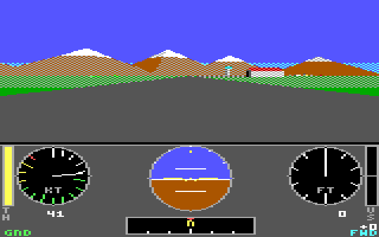 Takeoff roll, 41 knots | 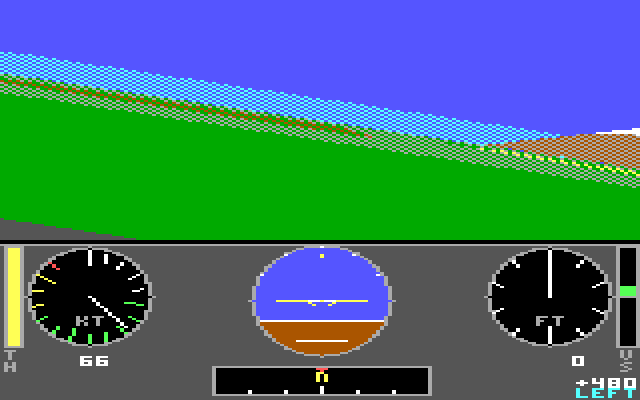 Rotating, left view (nose up shows as a tilt) |
| 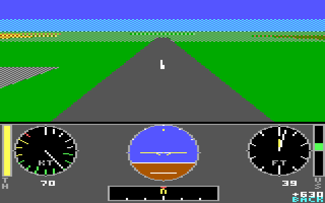 Climbing out, looking back at the runway | 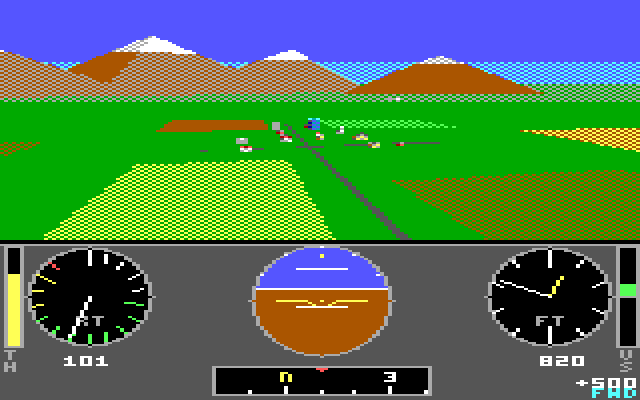 Over Juniper: roads, fields, buildings |
| 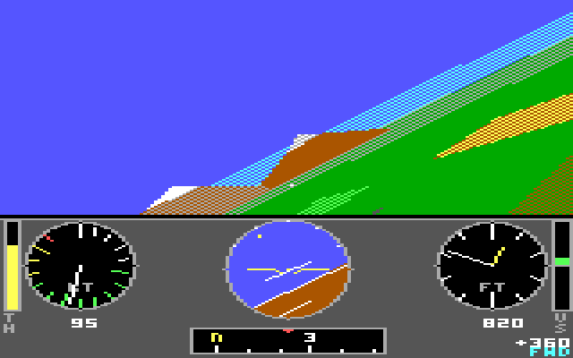 30-degree bank | 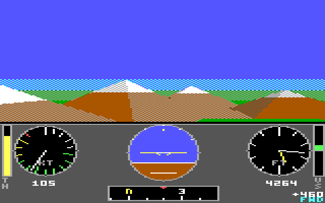 In the mountains at 4,300 ft |
| 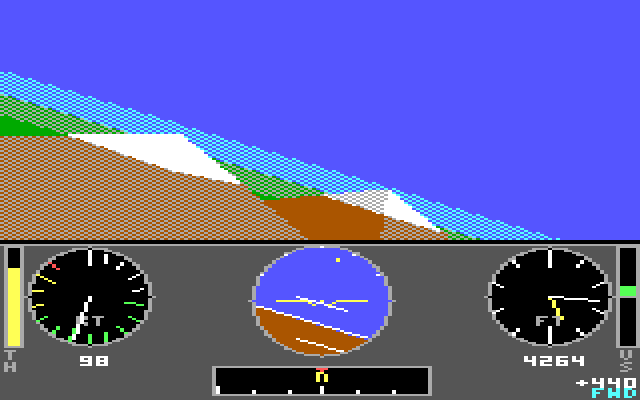 Turning past a peak |  Short final, runway 36 |
| 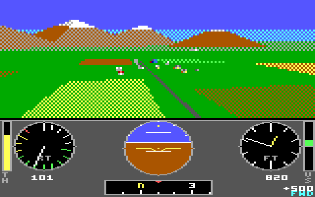 Low detail (the default): 160x60, lines doubled | 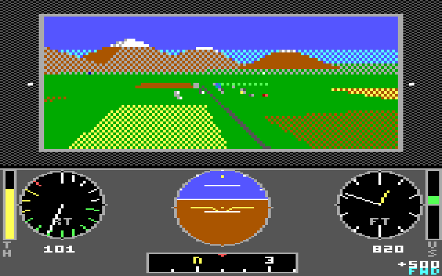 Medium window |
| 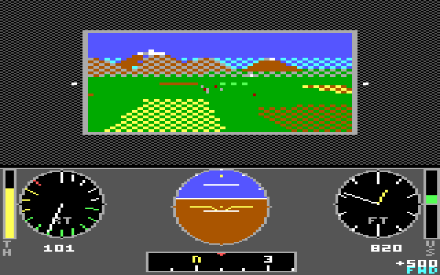 `/FAST`: small window, wide pixels, lines doubled | 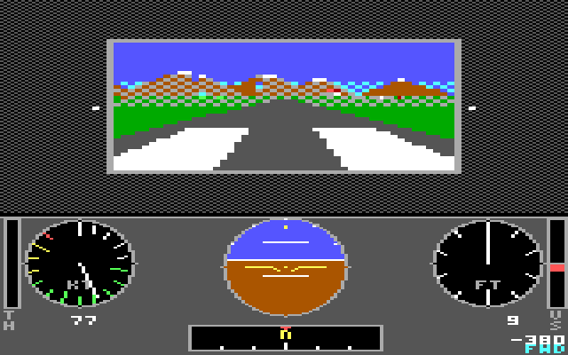 `/FAST` on short final |
